<div align="center">

# 🏥 MediScanAI

### A Safety-First, Multimodal, Evidence-Grounded Health Copilot

*Describe symptoms by text or voice, photograph a medicine strip, and get a structured, source-grounded verdict on whether the medicine fits the symptoms, with a deterministic emergency guardrail that never leaves life-or-death triage to an LLM.*

[](https://www.python.org/)
[](https://fastapi.tiangolo.com/)
[](https://react.dev/)
[](https://tailwindcss.com/)
[](https://www.postgresql.org/)
[-008CC1?logo=neo4j&logoColor=white)](https://neo4j.com/)
[](https://github.com/facebookresearch/faiss)
[](#-hybrid-retrieval-engine)
[-000000)](https://ollama.com/)
[-4285F4)](#-dual-mode-llm-layer)
[](#-testing)
[](#-docker-deployment)

</div>

> [!WARNING]
> **MediScanAI is a research and educational project, not a medical device.** It does not diagnose, prescribe, or replace a doctor or pharmacist. Production deployment is gated on clinical expert sign-off (see [Known Limitations](#-known-limitations--honest-caveats)). In an emergency, call **112** (India), **911** (US) or your local emergency number.

---

## 📖 Table of Contents

1. [What is MediScanAI?](#-what-is-mediscanai)
2. [Highlights](#-highlights)
3. [What's New Since the First README](#-whats-new-since-the-first-readme)
4. [System Architecture](#-system-architecture)
5. [Request Lifecycle](#-request-lifecycle)
6. [The AI Pipeline in Depth](#-the-ai-pipeline-in-depth)
   - [Input processing (OCR, speech, normalization)](#1-input-processing)
   - [Hybrid retrieval engine](#-hybrid-retrieval-engine)
   - [Neo4j knowledge graph (optional)](#-neo4j-knowledge-graph-optional)
   - [Dual-mode LLM layer](#-dual-mode-llm-layer)
   - [Prompt contract and injection defense](#-prompt-contract--prompt-injection-defense)
7. [Emergency Triage Guardrail](#-emergency-triage-guardrail)
8. [Data Engineering and Entity Resolution](#-data-engineering--entity-resolution)
9. [Backend Platform](#-backend-platform)
10. [Frontend](#-frontend)
11. [Evaluation Program and Results](#-evaluation-program--results)
12. [Tech Stack](#-tech-stack)
13. [Repository Layout](#-repository-layout)
14. [Configuration Reference](#-configuration-reference)
15. [Getting Started](#-getting-started)
16. [Docker Deployment](#-docker-deployment)
17. [API Reference](#-api-reference)
18. [Testing](#-testing)
19. [Security and Privacy Model](#-security--privacy-model)
20. [Known Limitations and Honest Caveats](#-known-limitations--honest-caveats)
21. [Roadmap](#-roadmap)
22. [Disclaimer](#-disclaimer)
23. [Author](#-author)

---

## 🩺 What is MediScanAI?

MediScanAI answers one practical question:

> **"Is the medicine I'm holding actually right for what I'm feeling?"**

A user can combine any of three inputs in a single request:

| Input | How it is processed |
|---|---|
| 📝 **Symptom text** | Spell-corrected, normalized, then searched against disease and drug corpora |
| 🎙️ **Voice notes** (WAV/MP3/WebM/OGG/M4A) | Transcribed locally by Faster-Whisper, then merged with typed text |
| 📷 **Photo of a medicine strip/box** | Read locally by PaddleOCR, then resolved against a drug dictionary and the FDA-derived drug catalog |

The system retrieves evidence with a **4-stage hybrid retriever** (dense FAISS + sparse BM25 + Reciprocal Rank Fusion + cross-encoder reranking), optionally enriches it with a **Neo4j knowledge graph**, and asks an LLM to write a verdict that is constrained to the retrieved evidence. A **deterministic, regex-based emergency guardrail** runs before and after the LLM so that red-flag symptoms (chest pain, stroke signs, anaphylaxis…) are escalated instantly, in microseconds, regardless of what the model would have said.

---

## ✨ Highlights

| | Capability | Why it matters |
|---|---|---|
| 🧠 | **Hybrid RAG** (FAISS + BM25 + RRF + cross-encoder) | Dense search catches meaning, BM25 catches exact drug names and typos, the reranker picks the best of both |
| 🚨 | **Deterministic emergency guardrail** (feature-flagged, fail-safe) | 10/10 emergency recall, 0/13 false positives on the safety regression suite; fast-path answers in ~0.05 ms |
| 🔀 | **Dual-mode LLM**: offline Ollama, or online Gemini → Groq chain | Private by default; cloud mode is an explicit, server-side opt-in |
| 🕸️ | **Optional Neo4j graph retrieval** with graceful degradation | Adds brand ↔ generic ↔ ingredient and disease ↔ symptom relationships; failure never blocks a request |
| 🧬 | **Entity-resolution toolchain** (FDA ↔ DailyMed ↔ ClinicalTrials) | Precision-first normalization of drug names, strengths, formulations and combinations |
| 📏 | **Rigorous evaluation program** (50-case benchmark, Ragas, ~20 audited phases) | Every claim is backed by a frozen config hash, integrity report and independent audit |
| 🔐 | **Production-minded backend** | JWT + bcrypt, rate limiting, concurrency slots, magic-byte upload validation, privacy-minimized audit log |
| 🖥️ | **Modern React 19 UI** | Text, voice recorder, image upload, history drawer, dark mode, verdict-colored cards |

---

## 🆕 What's New Since the First README

The original README described a simple *local FastAPI + React + Ollama* app. The project has grown substantially. Everything below is **new or materially changed** and is documented in this file.

| Area | Change |
|---|---|
| **LLM layer** | Added **online mode** (`LLM_MODE=online`): Gemini ×2 → Groq ×2 fallback chain in `app/llm_providers.py`. Mode is chosen **server-side**, never by the client. Offline Ollama remains the default. |
| **Emergency safety** | New `app/guardrail.py` + `app/guardrail_config.json`: 5 rule families, negation, history and contextual-exception handling, pre-generation **fast path**, post-generation enforcement, and a static fail-safe fallback. Controlled by `EMERGENCY_GUARDRAIL_*` flags. |
| **Knowledge graph** | New `app/graph/` package (driver + retriever) and `scripts/neo4j/` (schema, import, validation). Neo4j service added to `docker-compose.yml`. Fully optional via `NEO4J_ENABLED`. |
| **Data pipeline** | New `entity_resolution/` toolchain (v3.4) for normalizing and linking FDA, DailyMed and ClinicalTrials data, plus a "Final RAG V2" corpus builder with disk-backed dedup. |
| **Evaluation** | New `evaluation/` tree with a 50-case benchmark, narrative references, Ragas harness, retrieval experiments (Phases D.0 to D.2.c), baseline and safety audits (Phase 1.x) and grounding experiments (Phases F.1 to F.5). |
| **Pipeline robustness** | OCR failures degrade gracefully (clear user message plus emergency advice); image-only unreadable inputs get a safe fallback; multimodal text and OCR are fused for emergency detection. Fine-grained **per-stage timings** are returned with every analysis. |
| **Retrieval quality** | Adaptive score thresholds, intent routing and entity gating, validated in the D-series experiments (held-out Recall@5 improved from 0.11 to 0.56 strict, 0.78 entity-level). |
| **Backend hardening** | Rate limiter, concurrency slot manager, upload validator with magic bytes, correlation IDs, sanitized `error_id`s, data-minimized audit events, readiness probe (`/api/ready`). |
| **Persistence** | Alembic migrations `0001`–`0003`; `analyses` and `audit_logs` tables; history list/detail/delete endpoints. |
| **Frontend** | Voice recorder (multi-clip), image preview, analysis history drawer, verdict-aware card styling (suitable / unsuitable / caution), collapsible sections, staged loading indicator, light/dark theme. |
| **Testing** | **230+ test functions** across unit, API, database (SQLite + PostgreSQL), integration and E2E suites. |

---

## 🏗️ System Architecture

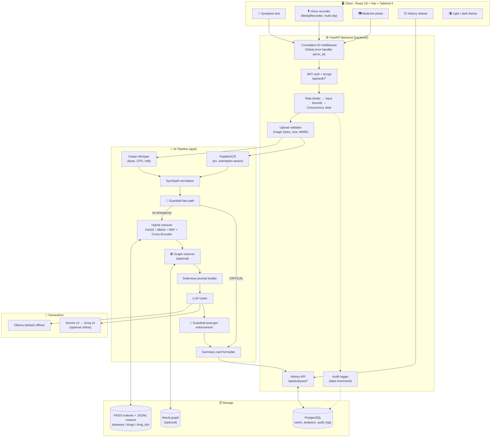

**Design principles**

1. **Safety before generation.** Emergencies are detected deterministically and short-circuit the LLM.
2. **Grounding before fluency.** The LLM sees only retrieved evidence and is told to ignore any instructions found in user or OCR text.
3. **Degrade, never crash.** OCR, Neo4j, guardrail config and LLM providers all have explicit fallback paths.
4. **Minimize data.** Raw images, audio and user text are not persisted; audit logs strip sensitive keys.
5. **Measure everything.** Each stage reports timings; each design change was evaluated against a frozen benchmark.

---

## 🔄 Request Lifecycle

What happens on `POST /api/analyze`:

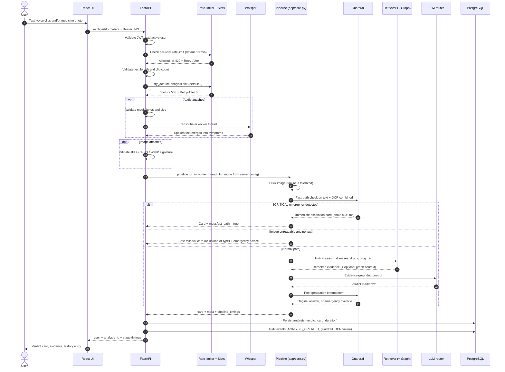

**Resilience at each hop**

| Failure | Behavior |
|---|---|
| Rate limit hit | `429` with `Retry-After`; `RATE_LIMIT_EXCEEDED` audit event |
| All analysis slots busy | `503` with `Retry-After: 5`; `CONCURRENCY_LIMIT_EXCEEDED` audit event |
| OCR engine exception | Pipeline continues; response carries `ocr_status: FAILED`; user is told to retype or re-upload |
| Neo4j down or slow | Logged and skipped; vector evidence is still used |
| Ollama unreachable or timeout | REST first, **CLI fallback**, then a sanitized `503` |
| All online providers fail | Sanitized `503`; online mode **never silently falls back to offline** |
| Guardrail config missing | Static **fail-safe keyword sweep** takes over |
| Unhandled exception | Global handler returns an opaque `error_id` (no stack traces) |

---

## 🧠 The AI Pipeline in Depth

### 1. Input processing

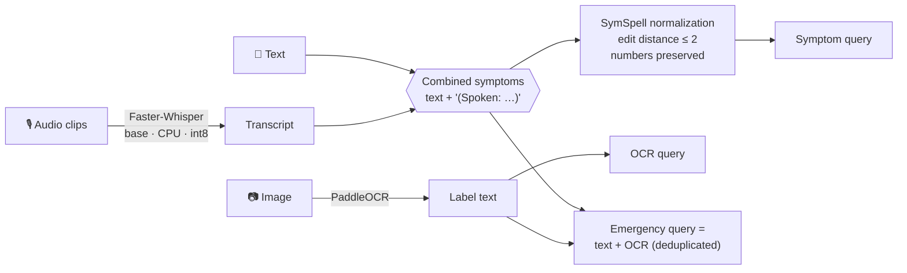

- **Speech** (`app/whisper.py`): Faster-Whisper `base`, CPU, `int8`, thread-locked; handles multiple clips per request (max 5 by default).
- **OCR** (`app/ocr.py`): lazy-loaded, lock-protected PaddleOCR with text-line orientation; returns text, polygon boxes and a preview image.
- **Normalization** (`app/utils.py`): SymSpell word-level correction (max edit distance 2) with **numeric tokens protected by placeholders**, so `500mg` and `0.5` are never "corrected".
- **Modality detection**: `text`, `audio`, `image` or `multimodal` is recorded for each analysis.

### 🔎 Hybrid Retrieval Engine

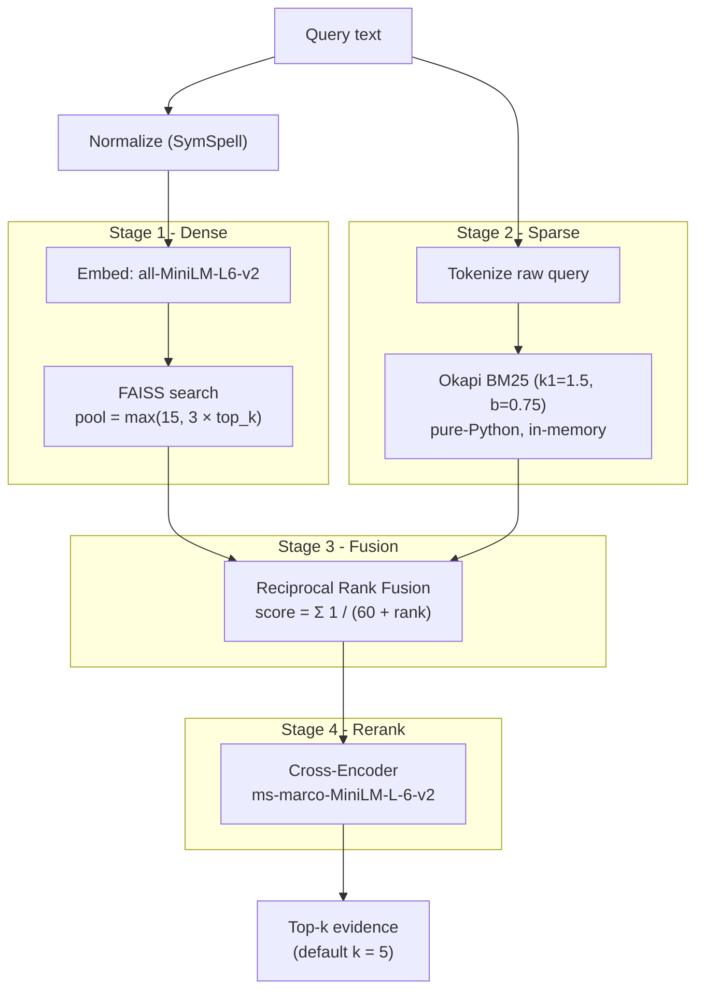

| Index | Records describe | Used for |
|---|---|---|
| `diseases` | Disease chunks with symptom lists | Matching the user's **symptoms** to conditions |
| `drugs` | FDA-style drug products (brand, generic, substances, indications, warnings, dosage, adverse reactions) | Suggesting candidate drugs for symptoms; resolving the **medicine on the photo** |
| `drug_dict` | Drug-name dictionary | Resolving noisy OCR output to a drug name |

**Query routing in `Pipeline.run`**

| Source text | Searches performed |
|---|---|
| Symptoms | `diseases` and `drugs` |
| OCR label | `drug_dict` and `drugs` |

Why four stages? Dense embeddings capture "tummy ache ≈ abdominal pain" but blur exact tokens like `Cinnarizine 25mg`; BM25 is the opposite. RRF merges them without needing comparable scores; the cross-encoder then rescoring each (query, document) pair jointly gives the final ordering.

> **Experimental findings (Phase D):** adaptive thresholds, an intent router and entity gating were evaluated offline and drove the retrieval gains below. Section-level max-pooling was tested and **rejected** because it reduced Recall@5 by 33% (it breaks the cross-encoder's joint attention across brand, substance and indication fields).

### 🕸️ Neo4j Knowledge Graph (optional)

Enabled with `NEO4J_ENABLED=true`. The graph **supplements** (never replaces) vector retrieval and every graph call is bounded by timeouts and returns a structured `status` (`success` / `error` / `timeout`).

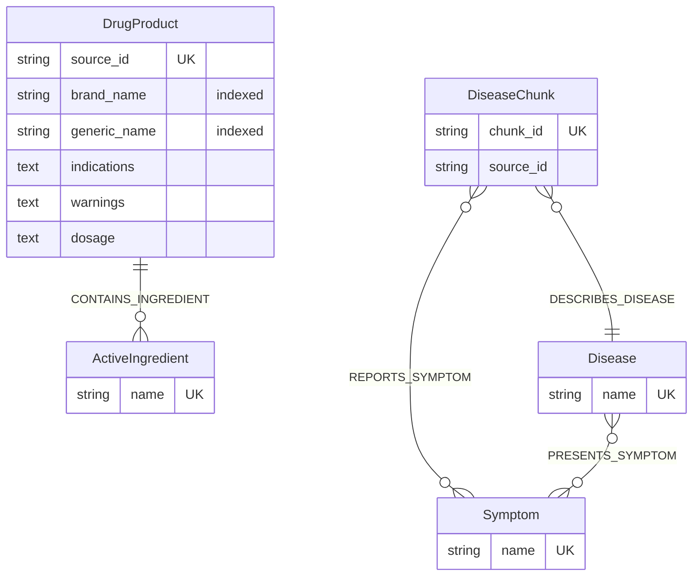

| Retriever method | Purpose |
|---|---|
| `find_drugs_by_name(name)` | Brand/generic lookup from OCR-resolved candidates |
| `find_drugs_by_ingredient(ingredient)` | Active-ingredient lookup |
| `find_diseases_by_symptoms(symptoms)` | Symptom-overlap disease ranking |
| `get_disease_neighborhood(disease)` | Chunks and symptoms around the top vector candidate |

All inputs are normalized and **clamped** (max chars, max symptoms, bounded limits) before reaching Cypher. Pipeline integration reuses the top vector candidates as graph seeds rather than raw user text.

**Scripts:** `scripts/neo4j/apply_schema.py` (uniqueness constraints + indexes), `import_data.py` (MERGE-based, idempotent), `validate_data.py`.

> **Honest result:** a paired 50-case Ragas evaluation (Phase C.5) found **no statistically reliable overall gain** from graph augmentation. It helps on drug generic/brand/ingredient lookups and single-symptom recall, and *hurts* on complex multi-hop queries by inducing verbose, tangential answers. That is why it is **optional and off by default**.

### 🔀 Dual-Mode LLM Layer

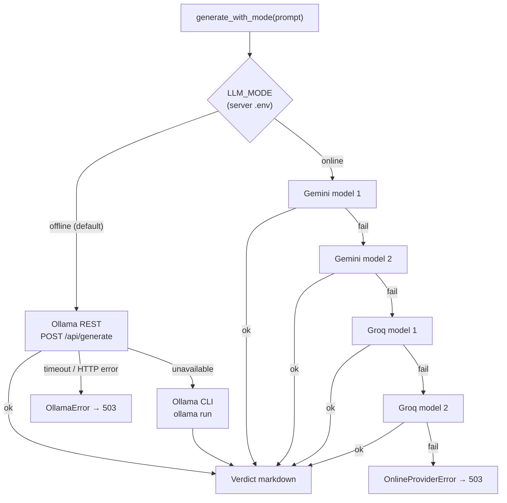

- **Offline** uses Ollama (`OLLAMA_MODEL`, default `mistral`) with separate connect (5 s) and read (60 s) timeouts and a CLI fallback.
- **Online** walks Gemini → Gemini → Groq → Groq (models set by `GEMINI_MODEL_1/2`, `GROQ_MODEL_1/2`). API keys live only in server config and are **never logged** or placed in error messages.
- Modes **never cross automatically**: online never falls back to a local model, offline never calls the cloud.
- The mode is read from **server config**, not from the request, so a client cannot force data off the machine.

**Model selection evidence (Phase C.2, 10-case pilot):** `llama3.1:8b` beat `mistral` on groundedness (5.0 vs 4.7), abstention on negative controls, emergency wording, and median latency (**14.1 s vs 27.4 s**), while Mistral scored higher on completeness and formatting. The default remains `mistral` in config; the evaluation harness used `llama3.1:8b`. Both are one `.env` change away.

### 📝 Prompt Contract & Prompt-Injection Defense

`app/prompt.py` enforces a strict output contract:

1. **Verdict first**: *"Based on the information provided, the medicine… is **suitable / not suitable**…"*
2. **Explanation**: why there is (or isn't) a mismatch.
3. **`### Suggested Alternatives`**: active ingredients (not brands) drawn **only** from symptom-side drug context.
4. **`### ⚠️ Important Warning`**: mandatory verbatim disclaimer.

Untrusted inputs are wrapped in `<USER_SYMPTOMS_TEXT>` and `<OCR_MEDICINE_TEXT>`; retrieved reference data in `<CONTEXT_FOR_SYMPTOMS>` and `<CONTEXT_FOR_MEDICINE>`. The prompt explicitly instructs the model to treat all of it as data, never as instructions, and to ignore phrases like *"ignore previous instructions"* or requests to drop warnings.

---

## 🚨 Emergency Triage Guardrail

*Module:* `app/guardrail.py` · *Rules:* `app/guardrail_config.json` · *Flag:* `EMERGENCY_GUARDRAIL_ENABLED`

**Why it exists.** During baseline evaluation (Phase 1.2.a), the query *"Chest pain"* retrieved evidence about acute coronary syndrome, yet the LLM advised scheduling a routine primary-care appointment. For a heart attack, that delay can be fatal. The fix is **not** a better prompt; it is a deterministic safety layer that does not depend on model behavior.

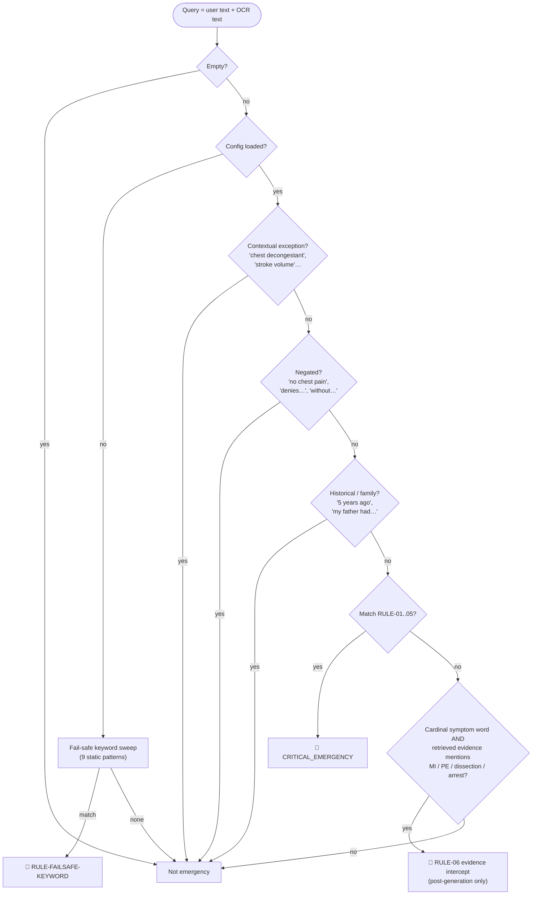

| Rule | Category | Examples of what it catches |
|---|---|---|
| `RULE-01` | Cardiovascular | chest pain/pressure/tightness, "heart attack", pain radiating to arm/jaw |
| `RULE-02` | Respiratory | severe breathlessness, gasping, throat swelling, anaphylaxis, stridor, cyanosis |
| `RULE-03` | Neurological | facial droop, sudden one-sided weakness, slurred speech, thunderclap headache |
| `RULE-04` | Consciousness | unconscious, unresponsive, collapse |
| `RULE-05` | Hemorrhage | severe/massive bleeding patterns |
| `RULE-06` | Evidence intercept | ambiguous chest/breathing query where retrieved evidence surfaces a life-threatening condition |

**Two-stage integration in `Pipeline.run`**

| Stage | When | Effect |
|---|---|---|
| **Fast path** | After OCR, before retrieval and LLM | `CRITICAL_EMERGENCY` returns an escalation card immediately, **skipping 3–8 s of LLM latency** and all LLM compute |
| **Post-generation** | After LLM output | Replaces the answer if an emergency is found, and **removes contradictory "book a routine appointment" language** |

The escalation message tells the user to call emergency services (112 / 911), go to the nearest ED, **not drive themselves**, and not substitute home remedies, while preserving diagnostic uncertainty and the mandatory disclaimer. Negative-control abstentions ("cannot provide medical advice") are preserved untouched.

**Measured results (Phase 1.2.d, 28-case safety regression):**

| Metric | Result |
|---|---|
| Emergency recall | **10 / 10 (100%)** |
| Non-emergency false positives | **0 / 13 (0%)** |
| Negative-control abstention preserved | **5 / 5** |
| Contradictory routine-care advice | **0** occurrences |
| Fast-path latency | **~0.051 ms** |
| Flag-off fidelity | **100%** identical to pre-integration behavior |
| Rollback time (flip flag) | **~4.7 ms** |
| Integration tests | **23 / 23** passing |

> ⚙️ **The guardrail ships disabled** (`EMERGENCY_GUARDRAIL_ENABLED=false`) pending clinical sign-off. **Set it to `true` in any environment where real users could type real symptoms.**

---

## 🧬 Data Engineering & Entity Resolution

The `entity_resolution/` toolchain builds the clean, linked corpora that feed the retriever and graph. It was engineered for **precision-first matching** and for a **16 GB laptop** (disk-backed SQLite dedup, bounded worker pools, no full-bucket RAM loads).

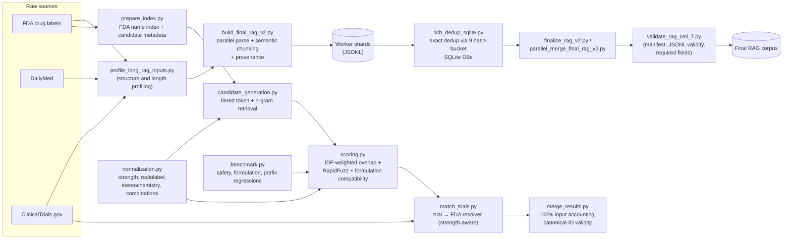

| Component | Role |
|---|---|
| `normalization.py` | Biomedical intervention parser: explicit strengths, bare numeric strengths (FDA names), development IDs, radiolabels, stereochemistry, combinations |
| `prepare_index.py` | Builds the FDA name index with precomputed candidate metadata |
| `candidate_generation.py` | Multi-tier candidate retrieval that **avoids unindexed global fuzzy scans** |
| `scoring.py` | Precision-first verdicts (`MatchVerdict`: status, method, canonical IDs, confidence, margin) |
| `match_trials.py` | Resolves clinical-trial interventions to FDA drugs, recovering missing IDs via unique normalized aliases |
| `merge_results.py` | Checkpoint merge, dedup and validation with full accounting |
| `benchmark.py` | Regression suite for **safety invariants** (e.g. combination ≠ monotherapy, formulation and prefix traps) |
| `build_*` / `finalize_*` / `rich_dedup_sqlite.py` | Parallel, shard-based "Final RAG V2" corpus construction |

> The `entity_resolution/` code is deliberately **isolated** from the runtime app, and the evaluation phases are logged as having had zero access to it.

---

## 🛡️ Backend Platform

```
backend/
├── main.py            # App, startup warm-up, /api/analyze, health + readiness
├── api/               # auth.py · analyses.py · deps.py (auth dependencies)
├── core/              # config · security · rate_limiter · concurrency · upload_validator
│                      #   · middleware · errors · audit
├── db/                # SQLAlchemy base + session
├── models/            # User · Analysis · AuditLog
└── schemas/           # Pydantic request / response models
```

### Data model

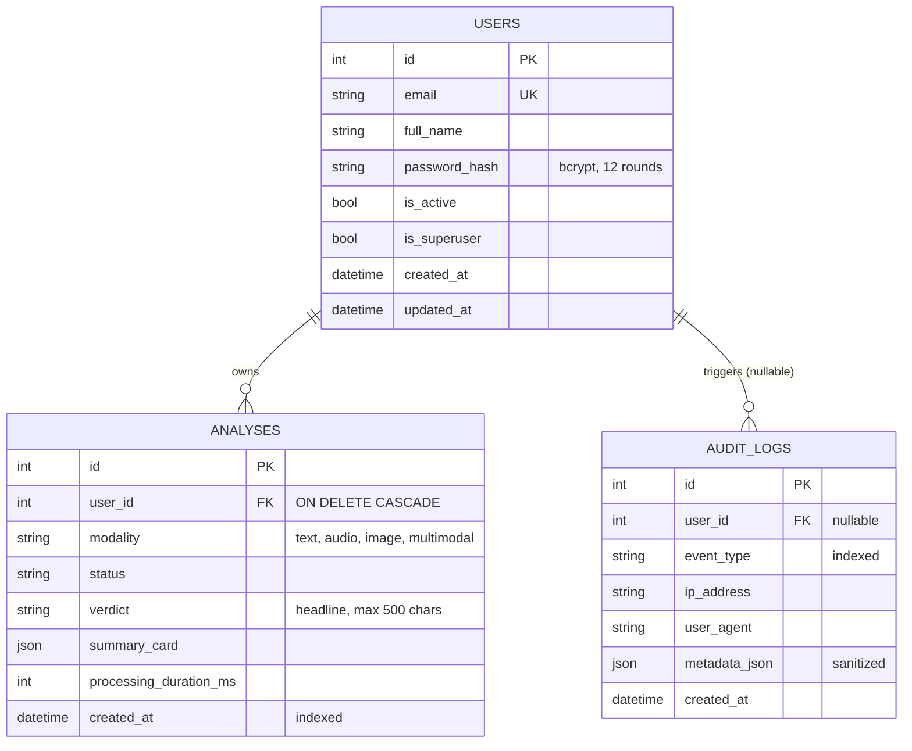

Migrations (Alembic): `0001_initial_schema` → `0002_add_user_full_name` → `0003_add_analysis_and_audit_tables`.

### Protection layers on `/api/analyze`

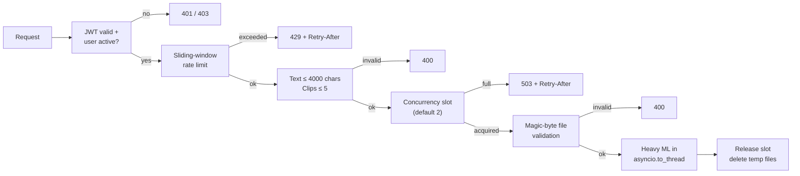

| Layer | Implementation |
|---|---|
| **Authentication** | `bcrypt` (12 rounds), HS256 JWTs (`sub`, `exp`), 60-min default expiry, active-user and superuser dependencies |
| **Rate limiting** | Thread-safe in-memory sliding window, applied **per user on `/api/analyze`** (`RATE_LIMIT_AUTH_PER_MINUTE` exists in config but is not yet wired into the auth routes) |
| **Concurrency** | `AnalysisSlotManager`: bounded, thread-safe, loop-agnostic (works under pytest event loops) |
| **Upload safety** | Extension allow-list, size limits (10 MB image, 25 MB audio), **binary signature checks** (JPEG, PNG, WebP, WAV, MP3, WebM, …), randomized temp paths, guaranteed cleanup |
| **Non-blocking compute** | Whisper, the RAG pipeline and LLM calls run in worker threads so the event loop stays responsive |
| **Observability** | `X-Request-ID` propagation (validated, or regenerated) plus opaque `error_id` per unhandled error |
| **Audit** | Event types include `ANALYSIS_CREATED`, `RATE_LIMIT_EXCEEDED`, `CONCURRENCY_LIMIT_EXCEEDED`, `EMERGENCY_GUARDRAIL_TRIGGERED`, `OCR_PROCESSING_FAILED`, `AUTH_REGISTER`, `AUTH_REGISTER_FAILED`, `AUTH_LOGIN_SUCCESS`, `AUTH_LOGIN_FAILURE`; **forbidden keys** (`password`, `token`, `jwt`, `user_text`, `symptoms`, …) are stripped; audit failures never break the main flow |
| **Config safety** | Pydantic settings; in `production` a wildcard CORS origin is **rejected at startup**; Neo4j settings are validated when enabled |
| **Health** | `/api/health` (liveness), `/api/ready` (DB + models + Ollama + concurrency) |
| **Warm start** | Startup pre-loads the pipeline (embeddings, FAISS, BM25, cross-encoder) and Whisper and prints a timing table |

---

## 🖥️ Frontend

**React 19 · Vite 8 · Tailwind CSS 4 · lucide-react · react-markdown + remark-gfm**

| Feature | Details |
|---|---|
| **Auth** | Landing page with register/login; token and user stored in `localStorage`; a `401` clears the session and prompts re-login |
| **Multimodal composer** | Text area, **in-browser voice recorder** (MediaRecorder, multiple clips, per-clip playback and deletion), medicine image upload with preview |
| **Staged progress** | Multi-step loading indicator while the pipeline runs |
| **Verdict-aware cards** | The LLM verdict is classified and styled: 🟢 suitable · 🟡 caution/uncertain · 🔴 unsuitable/emergency |
| **Markdown rendering** | Structured verdict, explanation, alternatives and warning sections, collapsible |
| **History drawer** | Recent analyses (latest 30 via the paginated API); open details; delete individual records |
| **Theme** | Light/dark, persisted |
| **Config** | `VITE_API_BASE_URL` (defaults to `http://127.0.0.1:8000`); endpoints centralized in `src/config/api.js` |

---

## 📏 Evaluation Program & Results

Evaluation is a first-class part of this repository. Work is organized into numbered **phases**; each has a README or report, an `integrity_report.json` and, where relevant, an independent audit and a **frozen configuration hash** (`f3937376cd191ee7` for the selected retrieval config).

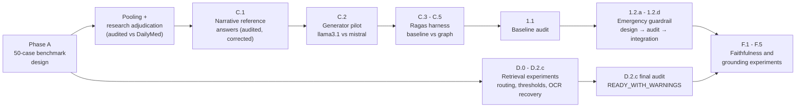

### The benchmark

`evaluation/benchmark/` holds **50 queries** and **57 candidate judgments** over 11 categories (brand/generic/ingredient lookup, brand↔generic relationships, single- and multi-symptom retrieval, synonym wording variants, ambiguous queries, insufficient-evidence/unanswerable, graph-relevant and graph-neutral), sampled with seed `42` and split into **Dev (30) / Validation (10) / Held-out (10)**.

> **Disclosure:** `gold_judgments.jsonl` is intentionally **0 bytes**. Judgments are *candidate* labels adjudicated against DailyMed with audits, but **not clinician-verified gold**. All metrics below should be read with that caveat.

### Retrieval results (held-out split, N = 10, frozen config)

| Metric | D.1 baseline | D.2.a routed | **D.2.c final (CFG-04)** |
|---|:---:|:---:|:---:|
| Strict record Recall@5 | 0.111 | 0.667 | **0.556** |
| Strict record MRR@10 | 0.056 | 0.537 | **0.500** |
| Canonical-entity Recall@5 (active-substance match) | n/a | n/a | **0.778** |
| Negative-control rejection | 0% | 0% | **100%** |
| OCR regression pass rate | n/a | 7/7 | **7/7** |
| Safety invariants | 2/5 (40%) | 12/12 | **14/14 (100%)** |
| Critical safety failures | 3 | 0 | **0** |
| Latency p50 / p95 | n/a | n/a | **1.4 s / 1.8 s** |

The small drop from D.2.a to D.2.c on strict recall was **fully reconciled**: one low-scoring lay-phrased multi-symptom query was pruned by the calibrated threshold (τ = −0.5), the same threshold that eliminated a false-positive on a negative control. This was an explicit safety-over-recall trade-off, documented in the final audit (`READY_WITH_WARNINGS`; three bounded, non-critical router defects remain, e.g. the `"oral"` keyword collision).

### Generation and grounding results

| Study | Finding |
|---|---|
| **C.2 model pilot** | `llama3.1:8b` preferred: groundedness 5.0 vs 4.7, median latency 14.1 s vs 27.4 s (48.6% faster); Mistral better at completeness and format |
| **C.5 Ragas, baseline vs graph (N = 50)** | Faithfulness 0.584 vs 0.570, Answer Relevancy 0.753 vs 0.775, Context Precision 0.893 vs 0.869, Context Recall 0.619 vs 0.604, all deltas' 95% bootstrap CIs include 0, so **no reliable overall benefit**. Zero distractor adoption on 5 negative controls; 100% mandatory-warning compliance |
| **F.4 → F.5 fact-only grounding (Dev, N = 30)** | Faithfulness ≈ 0.87 overall (0.90 answerable-only). Phase F.5 diagnosed that correct abstentions score 0.0 on Ragas *Answer Relevancy* as a mathematical artifact, and introduced **abstention-aware dual reporting** so real relevancy isn't masked |
| **Safety (all phases)** | Emergency escalation, fictional-drug abstention, non-prescribing for symptom queries and rejection of cure claims all at 100% on the final suites |

### Evaluation invariants (enforced and verified in each phase report)

Gold file untouched · no cloud API calls during evaluation (local Ollama + local embeddings) · frozen retrieval hash · no production code edits during analysis phases · held-out split unblinded only once.

<details>
<summary><b>📂 Where to find what in <code>evaluation/</code></b></summary>

| Path | Contents |
|---|---|
| `benchmark/` | Queries, candidate judgments, schema, metric contract, human-review protocol, narrative references (audit → correction → promotion), research adjudication, DailyMed verification |
| `model_pilot/phase_c_2/` | Generator comparison, rubric, failure analysis, recommendation |
| `ragas/phase_c_3…c_5/` | Ragas setup, generation runs, paired evaluation, integrity and bias/limitations analysis, bootstrap verification |
| `retrieval/phase_d_*` | Retrieval baselines and experiments: tokenizer, intent router, section reranker, threshold calibrator, OCR recovery |
| `retrieval/phase_1_1…1_2_d*` | Baseline audits, emergency guardrail design, independent audits, production integration and remediation |
| `retrieval/phase_f_*` | Faithfulness diagnosis and grounded-generation prompt experiments |
| `retrieval/metrics.py`, `schemas.py`, `run_retrieval_evaluation.py` | Reusable deterministic metrics: Recall@k, Hit-rate, MRR, nDCG, rejection accuracy |

</details>

---

## 🧩 Tech Stack

| Layer | Technology | Purpose |
|---|---|---|
| **Frontend** | React 19, Vite 8, Tailwind CSS 4, lucide-react, react-markdown, remark-gfm | UI, voice recorder, history, markdown rendering |
| **API** | FastAPI, Uvicorn, Starlette, Pydantic v2 / pydantic-settings | Async REST API and typed config |
| **Database** | PostgreSQL 15, SQLAlchemy 2, Alembic, psycopg2 | Users, analyses, audit logs, migrations |
| **Auth** | bcrypt, PyJWT (HS256), email-validator | Credentials and tokens |
| **OCR** | PaddleOCR 3.2 (PaddlePaddle 3.0), OpenCV | Medicine-label text extraction |
| **Speech** | Faster-Whisper (CPU, int8) | Local voice transcription |
| **Text normalization** | SymSpellPy | Typo correction with numeric protection |
| **Dense retrieval** | FAISS (CPU), SentenceTransformers `all-MiniLM-L6-v2` | Semantic search |
| **Sparse retrieval** | In-house Okapi BM25 | Exact-term recovery |
| **Reranking** | Cross-encoder `ms-marco-MiniLM-L-6-v2` | Joint (query, document) scoring |
| **Graph (optional)** | Neo4j 5.26 community, `neo4j` driver | Relationship retrieval |
| **LLM (offline)** | Ollama (`mistral` default; `llama3.1:8b` evaluated) | Local generation |
| **LLM (online, optional)** | Google Gemini → Groq (REST) | Cloud generation with fallback chain |
| **Entity resolution** | Python, RapidFuzz, SQLite, multiprocessing | Corpus building and linking |
| **Evaluation** | Ragas 0.2.x, LangChain, local Ollama judge | Faithfulness, relevancy, precision, recall |
| **Quality** | pytest, pytest-asyncio, pytest-cov, oxlint | Tests and linting |
| **Packaging** | Docker, Docker Compose | Reproducible deployment |

---

## 📂 Repository Layout

```
MediscanAI/
├── app/                          # Core AI pipeline
│   ├── core.py                   #   Pipeline orchestrator (OCR → guardrail → retrieval → graph → LLM → guardrail)
│   ├── retriever.py              #   FAISS + BM25 + RRF + Cross-Encoder (MultiRetriever)
│   ├── embeddings.py             #   all-MiniLM-L6-v2 embeddings
│   ├── ocr.py                    #   PaddleOCR wrapper (lazy, lock-protected)
│   ├── whisper.py                #   Faster-Whisper transcriber
│   ├── llm.py                    #   Ollama client (REST + CLI fallback) + mode router
│   ├── llm_providers.py          #   Gemini/Groq online fallback chain
│   ├── prompt.py                 #   Defensive, structured prompt template
│   ├── guardrail.py              #   Deterministic emergency triage guardrail
│   ├── guardrail_config.json     #   Rules, negation/history patterns, hotlines
│   ├── formatter.py              #   Summary-card builder
│   ├── utils.py                  #   JSONL loader, SymSpell normalization
│   └── graph/                    #   Neo4j driver + GraphRetriever
├── backend/                      # FastAPI platform (see "Backend Platform")
├── frontend/                     # React 19 + Vite + Tailwind 4 SPA
├── alembic/                      # DB migrations 0001–0003
├── entity_resolution/            # Corpus-building and entity-linking toolchain
│   └── scripts/
├── scripts/neo4j/                # Graph schema, import and validation
├── evaluation/                   # Benchmark, Ragas, retrieval, safety and grounding studies
├── tests/                        # unit/ api/ database/ integration/ + top-level suites
├── data/                         # ⚠ not in git: JSONL corpora (see "Data assets")
├── indexes/                      # ⚠ not in git: prebuilt FAISS indexes
├── Dockerfile · docker-compose.yml · .env.example
├── start.sh · run_tests.sh · pytest.ini · requirements.txt
└── README.md
```

### Data assets

The runtime requires files that are **large and not committed**:

| Path | Needed by |
|---|---|
| `data/diseases_faiss_data.jsonl`, `data/drugs_faiss_data.jsonl`, `data/drug_dict_faiss_data.jsonl` | Retriever, BM25, Neo4j import |
| `indexes/diseases_faiss.index`, `indexes/drugs_faiss.index`, `indexes/drug_dict_faiss.index` | FAISS dense search |
| `data/frequency_dictionary_en_82_765.txt` | SymSpell spell-checking |

> 💡 Host these as a **GitHub Release asset**, **Git LFS** object or external download and document the URL here. The ~700 MB footprint is mostly these corpora and indexes, not code.

---

## ⚙️ Configuration Reference

Copy `.env.example` to `.env`. Variables read by `backend/core/config.py`:

<details open>
<summary><b>Core</b></summary>

| Variable | Default | Description |
|---|---|---|
| `APP_NAME` / `APP_ENV` / `DEBUG` | `MediScanAI` / `development` / `false` | In `production`, wildcard CORS is rejected |
| `DATABASE_URL` | `postgresql+psycopg2://localhost:5432/mediscanai` | PostgreSQL URI |
| `DB_POOL_SIZE` / `DB_MAX_OVERFLOW` / `DB_POOL_TIMEOUT` / `DB_POOL_PRE_PING` | `5` / `10` / `30` / `true` | Connection pool |
| `JWT_SECRET_KEY` | **required** | Generate with `openssl rand -hex 32` |
| `JWT_ALGORITHM` / `ACCESS_TOKEN_EXPIRE_MINUTES` | `HS256` / `60` | Token settings |
| `CORS_ORIGINS` | localhost:5173 (+`*` in dev) | Explicit origins required in production |

</details>

<details open>
<summary><b>Limits and protection</b></summary>

| Variable | Default | Description |
|---|---|---|
| `MAX_IMAGE_SIZE_BYTES` | `10485760` | 10 MB |
| `MAX_AUDIO_SIZE_BYTES` | `26214400` | 25 MB |
| `MAX_TEXT_LENGTH` | `4000` | Symptom text characters |
| `MAX_AUDIO_CLIPS_COUNT` | `5` | Clips per request |
| `RATE_LIMIT_ANALYZE_PER_MINUTE` / `RATE_LIMIT_AUTH_PER_MINUTE` | `10` / `20` | Sliding windows |
| `MAX_CONCURRENT_ANALYSES` | `2` | Simultaneous ML analyses |

</details>

<details open>
<summary><b>LLM</b></summary>

| Variable | Default | Description |
|---|---|---|
| `LLM_MODE` | `offline` | `offline` (Ollama) or `online` (Gemini → Groq) |
| `OLLAMA_BASE_URL` / `OLLAMA_MODEL` | `http://localhost:11434` / `mistral` | Local model endpoint and tag |
| `OLLAMA_CONNECT_TIMEOUT_SECONDS` / `OLLAMA_READ_TIMEOUT_SECONDS` | `5.0` / `60.0` | Timeouts |
| `GEMINI_API_KEY` / `GROQ_API_KEY` | empty | Required only for `online` mode |
| `GEMINI_MODEL_1` / `GEMINI_MODEL_2` | see `config.py` | Tried in order |
| `GROQ_MODEL_1` / `GROQ_MODEL_2` | see `config.py` | Tried in order |
| `ONLINE_LLM_TIMEOUT_SECONDS` | `60.0` | Per-provider timeout |

</details>

<details open>
<summary><b>Safety and graph</b></summary>

| Variable | Default | Description |
|---|---|---|
| `EMERGENCY_GUARDRAIL_ENABLED` | **`false`** | Master switch, **enable for real use** |
| `EMERGENCY_GUARDRAIL_FAST_PATH` | `true` | Skip LLM on CRITICAL emergencies |
| `EMERGENCY_GUARDRAIL_CONFIG_PATH` | `app/guardrail_config.json` | Rule file (relative paths resolved from repo root) |
| `NEO4J_ENABLED` | `false` | Enable graph retrieval |
| `NEO4J_URI` / `NEO4J_USER` / `NEO4J_PASSWORD` | `bolt://localhost:7687` / `neo4j` / (required if enabled) | Use `bolt://neo4j:7687` inside Compose |
| `NEO4J_CONNECTION_TIMEOUT_SECONDS` / `NEO4J_MAX_CONNECTION_LIFETIME_SECONDS` / `NEO4J_MAX_CONNECTION_POOL_SIZE` | `5.0` / `3600` / `50` | Driver tuning |

</details>

---

## 🚀 Getting Started

### Prerequisites

- Python **3.10** (Conda recommended), Node.js **18+**
- PostgreSQL **15+**
- [Ollama](https://ollama.com) (offline mode), *or* Gemini/Groq API keys (online mode)
- *(Optional)* Neo4j 5.x
- The [data assets](#data-assets) placed in `data/` and `indexes/`
- ~8 GB free RAM recommended (embeddings + cross-encoder + Whisper + OCR + a 7–8B local LLM)

### 1. Install

```bash
git clone https://github.com/djcode0718/MediscanAI.git
cd MediscanAI

conda create -n med-env python=3.10 -y
conda activate med-env
pip install -r requirements.txt

cp .env.example .env      # then edit JWT_SECRET_KEY and the options you need
```

### 2. Database

```bash
createdb mediscanai
alembic upgrade head
```

### 3. Local LLM (offline mode)

```bash
ollama pull mistral           # default; llama3.1:8b is also evaluated
```

### 4. (Optional) Knowledge graph

```bash
docker compose up -d neo4j
python scripts/neo4j/apply_schema.py
python scripts/neo4j/import_data.py
python scripts/neo4j/validate_data.py
# then in .env:  NEO4J_ENABLED=true  NEO4J_PASSWORD=<your password>
```

### 5. Recommended `.env` for a safe local run

```ini
APP_ENV=development
JWT_SECRET_KEY=<openssl rand -hex 32>
LLM_MODE=offline
EMERGENCY_GUARDRAIL_ENABLED=true
NEO4J_ENABLED=false
```

### 6. Run

**One command** (checks Ollama and the model, validates the conda env, installs frontend deps, starts both servers and streams logs):

```bash
chmod +x start.sh && ./start.sh
```

**Or manually**

```bash
# Terminal 1 - API
uvicorn backend.main:app --host 127.0.0.1 --port 8000 --reload

# Terminal 2 - UI
cd frontend && npm install && npm run dev
```

Open **http://localhost:5173**. Interactive API docs at **http://127.0.0.1:8000/docs**.

> ⏱️ First start takes a while: the embedding model, FAISS indexes, BM25 indexes, cross-encoder and Whisper are pre-warmed and a startup timing report is printed.

---

## 🐳 Docker Deployment

`docker-compose.yml` defines three services:

| Service | Image | Notes |
|---|---|---|
| `postgres` | `postgres:15-alpine` | Healthcheck, persistent volume `pgdata` |
| `neo4j` | `neo4j:5.26.0-community` | Optional; ports 7474/7687, volume `neo4jdata` |
| `backend` | built from `Dockerfile` (Python 3.10-slim + ffmpeg, OpenCV libs) | Runs as **non-root** `appuser`; reaches host Ollama via `host.docker.internal:11434` |

```bash
docker compose up --build -d
docker compose ps
curl http://localhost:8000/api/health
curl http://localhost:8000/api/ready
```

> ⚠️ The Compose file contains **development-only credentials** (database password, JWT secret). Override them with environment variables or a secrets manager before any shared or public deployment. Compose does not include the frontend; run it with `npm run build` and serve `frontend/dist`, or `npm run dev`.

---

## 🔌 API Reference

Base URL `http://127.0.0.1:8000` · all `/api/analyze` and `/api/analyses*` routes need `Authorization: Bearer <token>`.

| Method | Path | Auth | Description |
|---|---|:---:|---|
| `GET` | `/` | | Root ping |
| `GET` | `/api/health` | | Liveness |
| `GET` | `/api/ready` | | Readiness: DB, models loaded, Ollama, concurrency slots (`503` if not ready) |
| `POST` | `/api/auth/register` | | Create account → token (`201`) |
| `POST` | `/api/auth/login` | | Login → token |
| `GET` | `/api/auth/me` | ✅ | Current user |
| `POST` | `/api/analyze` | ✅ | Multimodal analysis (multipart) |
| `GET` | `/api/analyses?limit=20&offset=0` | ✅ | Paginated history (`limit` 1–100) |
| `GET` | `/api/analyses/{id}` | ✅ | Analysis detail (owner-only) |
| `DELETE` | `/api/analyses/{id}` | ✅ | Delete analysis (owner-only) |

### `POST /api/analyze`

Form fields (at least one required): `text` (string), `image` (file), `audio` (one or more files).

```bash
curl -X POST http://127.0.0.1:8000/api/analyze \
  -H "Authorization: Bearer $TOKEN" \
  -F "text=I have a dry cough and mild fever for two days" \
  -F "image=@strip.jpg"
```

Response shape (abridged):

```jsonc
{
  "analysis_id": 42,
  "card": {
    "user_text": "…",
    "ocr_text": "…",
    "llm_output": "Based on the information provided … ### Suggested Alternatives … ### ⚠️ Important Warning …",
    "retrieved": { "diseases": [ … ], "drugs": [ … ], "drug_dict": [ … ] }
  },
  "meta": {
    "ocr_status": "SUCCESS",          // SUCCESS | EMPTY | FAILED | SKIPPED
    "fast_path": false,
    "guardrail": { "is_emergency": false, "severity": null, "fired_rule_id": null }
  },
  "timings": {
    "whisper_ms": 0, "ocr_total_ms": 812,
    "retrieval_diseases_ms": 640, "retrieval_drugs_ms": 590,
    "llm_total_ms": 9100, "guardrail_post_gen_ms": 0,
    "db_persistence_ms": 8, "total_duration_ms": 11500
  }
}
```

| Status | Meaning |
|---|---|
| `400` | No input, text too long, too many clips, or invalid file |
| `401` / `403` | Missing/invalid token, or inactive account |
| `429` | Rate limit; see `Retry-After` |
| `503` | Slots busy, or LLM provider unavailable |
| `5xx` | Sanitized body containing an opaque `error_id` to match against server logs |

---

## 🧪 Testing

**230+ test functions** across:

| Suite | Path | Scope |
|---|---|---|
| Unit | `tests/unit/` | Concurrency limiter, rate limiter, security and bounds, LLM reliability, graph retriever, pipeline-graph integration, retrieval evaluation and benchmark logic |
| API | `tests/api/` | Auth, analyses CRUD and ownership, health/readiness |
| Database | `tests/database/` | SQLite (fast) and PostgreSQL layers |
| E2E smoke | `tests/test_e2e_smoke.py` | Full request lifecycle |
| Integration (real models) | `tests/integration/` | Real AI pipeline, emergency guardrail, multimodal emergency remediation |
| Component | `tests/test_*.py` | Embeddings, retriever, OCR, Whisper, LLM and providers, utils, pipeline, security, persistence |

```bash
./run_tests.sh                 # fast deterministic suite (unit + api + database + e2e)
./run_tests.sh --integration   # real-model integration tests (heavy)
./run_tests.sh --all           # everything
pytest tests/unit -v           # or run any module directly
```

The default test database is in-memory SQLite (`TEST_DATABASE_URL`), so the fast suite needs no running services.

---

## 🔐 Security & Privacy Model

| Concern | Approach |
|---|---|
| **Data locality** | Default `offline` mode keeps OCR, speech, retrieval and generation on your machine. **Online mode sends the assembled prompt (symptoms, OCR text, evidence) to Google and/or Groq.** Treat it as an explicit, informed opt-in |
| **Data minimization** | Raw images and audio are processed from randomized temp files and **deleted**; only the structured summary card, verdict headline and timing metadata are stored |
| **Audit hygiene** | Audit events carry IDs, rule names and durations, never raw text; sensitive keys are filtered on write |
| **Credentials** | bcrypt (12 rounds), constant-time verification, short-lived JWTs |
| **Upload attacks** | Extension + MIME + **magic-byte** checks, size caps, random filenames |
| **Prompt injection** | Delimited untrusted inputs plus explicit anti-injection instructions |
| **Abuse and DoS** | Per-user rate limits, bounded concurrency, bounded graph/LLM timeouts |
| **Error leakage** | Opaque `error_id`; stack traces stay server-side |
| **CORS** | Wildcard blocked when `APP_ENV=production` |
| **Secrets** | `.env` is git-ignored; provider keys never logged |

---

## ⚠️ Known Limitations & Honest Caveats

Calling these out openly is part of the project's evaluation culture.

| Area | Limitation |
|---|---|
| **Clinical validity** | Not clinically validated. Ground truth is *candidate* (audited, but not clinician-gold). Release remains gated on formal clinical sign-off |
| **Guardrail default** | Ships **off**. Rule-based triage covers 5 families only, so absence of a match is **not** evidence of safety. English only |
| **Retrieval ceiling** | Held-out strict Recall@5 is 0.56 (0.78 at active-substance level) on a **10-case** held-out split, so confidence intervals are wide. Known bounded router defects (e.g. `"oral"` collision) |
| **Graph value** | Neo4j augmentation shows no reliable aggregate gain and can dilute multi-hop answers, so it is optional |
| **Faithfulness** | Ragas faithfulness is ~0.58 (C.5) on free-text answers; the evaluator itself has documented bias and over-penalizes some abstentions and connective phrasing |
| **LLM variability** | `mistral` (default) vs `llama3.1:8b` (evaluated) trade completeness against groundedness and latency; outputs are non-deterministic across model versions |
| **Mismatch detection** | The pipeline reports `"Mismatch check not performed in this pipeline version"`; suitability is judged by the LLM, not a structured rule |
| **Language** | English-centric corpora, SymSpell dictionary and Whisper/OCR configuration |
| **Resource footprint** | Needs several GB of RAM; PaddleOCR + Whisper + cross-encoder + local LLM make this a server-class workload, not a phone-class one |
| **Scaling** | Rate limiter and slot manager are **in-process**: correct for a single instance, not distributed (swap for Redis to scale out) |
| **Auth throttling** | `RATE_LIMIT_AUTH_PER_MINUTE` is defined but login/register are not yet rate-limited, so add this before exposing the API publicly |
| **Config hygiene** | `.env.example` lists `*` among CORS origins and sets `NEO4J_ENABLED=true`; Compose embeds dev credentials; passwords require only 6 characters; JWT is kept in `localStorage`. Tighten all of these for production |
| **Logging** | Verbose `print` timing output is useful in development but should be moved to structured logging for production |

---

## 🗺️ Roadmap

- [ ] Clinician review → promote candidate judgments to gold; re-run held-out evaluation with a larger split
- [ ] Structured **drug-symptom mismatch** check (replace the "not performed" placeholder)
- [ ] Fix the remaining intent-router defects flagged in the D.2.c final audit
- [ ] Expand guardrail coverage (more red-flag families, multilingual triggers) and enable by default after sign-off
- [ ] Redis-backed rate limiting and shared state for multi-instance deployments
- [ ] Hosted frontend + **mobile packaging** (PWA/Capacitor against a hosted API; an on-device lite mode would need a lightweight OCR/embedding/LLM stack)
- [ ] Structured logging, metrics and tracing; CI pipeline running the fast test suite
- [ ] Publish data/index assets via Releases or Git LFS with checksums

---

## ⚠️ Disclaimer

**MediScanAI is built for educational, research and informational purposes only.** It does not provide medical diagnosis, prescription validation or treatment recommendations, and its outputs may be incomplete or wrong. Always consult a qualified doctor or pharmacist about health conditions and medications. If you or someone else may be having a medical emergency, **call your local emergency number immediately** (112 in India, 911 in the US).

---

## 👨‍💻 Author

**Sreevedh Jella**
AI · Healthcare · Privacy-First Systems
GitHub: [@djcode0718](https://github.com/djcode0718)

<div align="center">

*Built with a belief that health AI should be grounded, auditable and honest about what it doesn't know.*

</div>