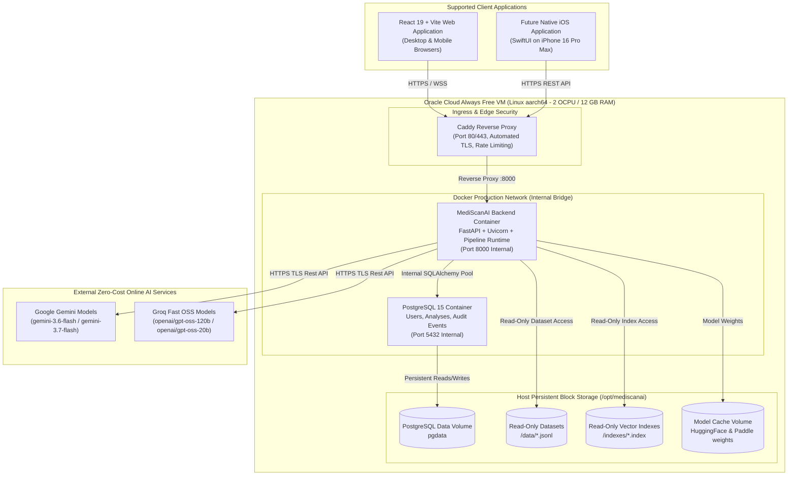
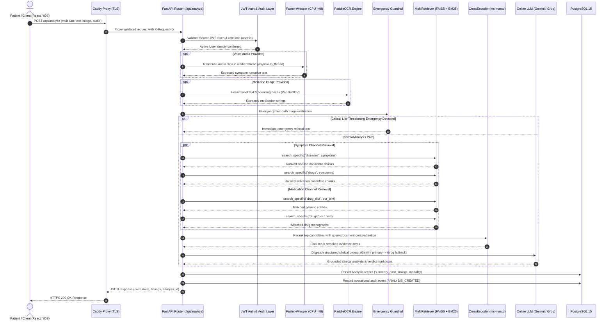

# MediScanAI — Architectural Blueprint: Current vs. Cloud Deployment

**Document Version:** 1.0.0 (Phase 1 Baseline)  
**Target Infrastructure:** Oracle Cloud Always Free (Ampere A1: 2 OCPUs, 12 GB RAM)  
**Cost Target:** Strictly ₹0 / month  

---

## 1. Architectural Evolution Overview

MediScanAI is an evidence-grounded multimodal AI health assistant that reads medicine packaging labels, transcribes spoken patient symptom narratives, performs hybrid dense+sparse knowledge retrieval with cross-encoder reranking, and synthesizes clinical guidance via online LLM APIs.



---

## 2. Current Local Implementation vs. Proposed Cloud Architecture

| Component | Current Local Development State | Proposed Production Cloud State | Architectural Rationale |
| :--- | :--- | :--- | :--- |
| **Host System** | macOS Darwin ARM64 (Apple Silicon M4) | Ubuntu 24.04 LTS aarch64 (Oracle Cloud Ampere A1) | Maximizes Always Free compute (2 OCPU / 12 GB RAM at ₹0/mo). |
| **Web Ingress** | Direct Uvicorn exposure (`127.0.0.1:8000`) | Caddy 2 Reverse Proxy (`:80` / `:443`) | Automated Let's Encrypt TLS certificates, security headers, request throttling. |
| **Database Exposure**| Exposed on `0.0.0.0:5432` in Docker Compose | Bound strictly to internal Docker bridge network | Closes critical security hole; prevents public database port exposure. |
| **LLM Inference** | Local Ollama (`llama3.1:8b` via Metal/CPU) | Pure Online APIs (`gemini-3.6/3.7-flash` + Groq `gpt-oss-120b/20b`) | Eliminates 6–8 GB local Ollama RAM load; offloads generation to external online LLMs (measured complete pipeline request: 31.98s; total pipeline execution duration in database: 31,930 ms). |
| **Readiness Probe** | Unconditionally checks Ollama at `/api/ready` | Dynamic check based on `LLM_MODE` | Prevents container restarts when running in pure cloud online mode. |
| **OCR Engine** | PaddleOCR (PaddlePaddle 3.0 lazy singleton) | PaddleOCR (PaddlePaddle 3.0 Linux aarch64) | Preserves PaddleOCR text extraction pipeline; verified via unit tests (`test_ocr.py`) on synthetic medicine strips with native ARM64 wheels. |
| **Embeddings & Vector**| Local SentenceTransformers + FAISS-CPU | Local SentenceTransformers + FAISS-CPU | Zero external API latency for vector search; pre-computed indexes mounted read-only. |
| **Knowledge Graph** | Neo4j 5.26 container declared in Compose | Excluded from minimal production Compose stack | Neo4j is optional (`NEO4J_ENABLED=false`). Saves 2.5 GB JVM memory on 12 GB VM. |
| **Model Caching** | Local `~/.cache` directory on host | Dedicated persistent Docker named volume | Eliminates repeated 450 MB model weight downloads on container recreation. |
| **Image Size** | Single-stage development build | Multi-stage Dockerfile | Measured local image: 11.66 GB uncompressed (3.89 GB containerd content size). Excludes build tools (`gcc`, `g++`, make); uses `opencv-python-headless`. |

---

## 3. Detailed Request Lifecycle & Internal Data Flow

The following sequence diagram traces an end-to-end multimodal analysis request through the application stack:



---

## 4. Component Lifecycle & Initialization State

```text
Application Startup (@app.on_event("startup")):
  ├── 1. PostgreSQL Connection Test (check_db_connection)
  ├── 2. Pre-warm RAG Pipeline (Pipeline.__init__)
  │     ├── Load FAISS indexes into memory (diseases, drugs, drug_dict) [~220 MB]
  │     ├── Build in-memory BM25 term frequency dictionaries [~280 MB]
  │     ├── Load SentenceTransformer embedding model ('all-MiniLM-L6-v2') [~150 MB]
  │     └── Load CrossEncoder reranker ('cross-encoder/ms-marco-MiniLM-L-6-v2') [~150 MB]
  ├── 3. Pre-warm Faster-Whisper Model ('base', compute_type="int8") [~180 MB]
  └── 4. Initialize Emergency Triage Guardrail (rule regex index) [~5 MB]

On-Demand (Lazy Initialization on First Request):
  └── PaddleOCR Model (PaddlePaddle 3.0 inference engine) [~650 MB]
        └── Triggered only when a user uploads a medicine image.
```

---

## 5. Storage & Volume Mount Mapping

```text
/opt/mediscanai/ (Host Root on Oracle Cloud VM)
  ├── .env.prod                                -> Read-only environment variables
  ├── docker-compose.prod.yml                  -> Production orchestration manifest
  ├── Caddyfile                                -> Reverse proxy routing configuration
  │
  ├── data/                                    -> Mounted to /app/data:ro inside container
  │     ├── diseases_faiss_data.jsonl (3.7 MB)
  │     ├── drug_dict_faiss_data.jsonl (2.9 MB)
  │     └── drugs_faiss_data.jsonl (103.4 MB)
  │
  ├── indexes/                                 -> Mounted to /app/indexes:ro inside container
  │     ├── diseases_faiss.index (5.2 MB)
  │     ├── drug_dict_faiss.index (89.6 MB)
  │     └── drugs_faiss.index (122.1 MB)
  │
  └── volumes/
        ├── pgdata/                            -> Named volume for PostgreSQL database
        ├── caddy_data/                        -> Automated TLS certificates & keys
        ├── caddy_config/                      -> Caddy internal configuration
        └── model_cache/                       -> Mounted to /home/appuser/.cache
              ├── huggingface/ (MiniLM, Whisper, CrossEncoder)
              └── paddlex/ (PaddleOCR weights)
```

