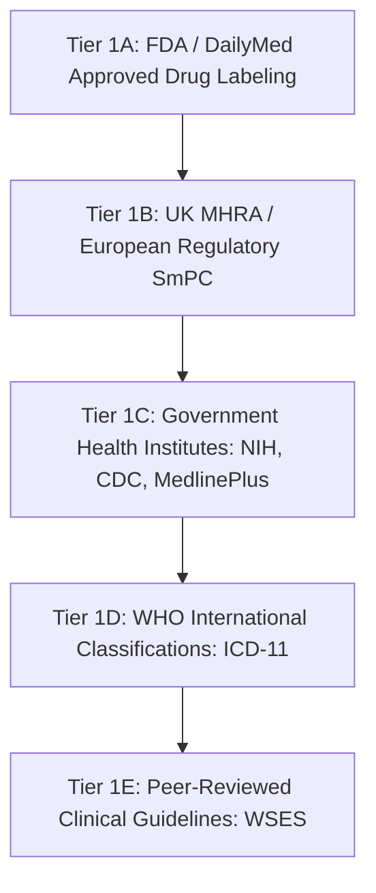

# MediScanAI — Phase A.3 Independent Evidence Adjudication Methodology

## 1. Protocol Overview & Legal Boundary

### 1.1 Purpose
This methodology defines the rigorous, automated, research-assisted adjudication protocol used to evaluate the 50-case MediScanAI retrieval benchmark. The objective is to create an objective, traceable, evidence-backed benchmark dataset that evaluates retrieval recall and precision across baseline and graph retrieval pipelines without requiring manual clinician adjudication.

### 1.2 Boundary & Integrity Notice
- **Not Human Clinical Review:** This adjudication is conducted by an automated evidence audit harness referencing authoritative medical literature and regulatory labeling.
- **Provenance Contract:** Every record explicitly sets:
  ```json
  "adjudicator_type": "ai_assisted_external_evidence",
  "human_reviewed": false
  ```
- **Gold File Preservation:** The official human ground-truth file (`evaluation/benchmark/gold_judgments.jsonl`) remains unmodified at **zero bytes**. Under no circumstances are AI-assisted evidence grades promoted to official human gold without certified clinician review as defined in Phase A.2 (`evaluation/benchmark/human_review/gold_promotion_policy.md`).

---

## 2. 10-Step Evidence Adjudication Procedure

For every candidate and negative control record:

1. **Query & Task Dissection:** Extract the canonical query string, query category, and retrieval task. Determine the target clinical entity type (brand, generic, active ingredient, disease pathology, or negative control).
2. **Corpus Record Inspection:** Retrieve the exact JSON object from `data/drugs_faiss_data.jsonl` or `data/diseases_faiss_data.jsonl` matching `source_record_id`. Extract all verbatim fields (`brand_name`, `generic_name`, `active_ingredients`, `disease`, `symptoms`, `adverse_reactions`).
3. **Target Claim Isolation:** Formulate the precise clinical or pharmacological proposition being evaluated (e.g., *"Does Advil contain ibuprofen?"*, *"Does acute sinusitis present with facial tenderness?"*).
4. **Independent Primary Source Querying:** Identify the primary authoritative regulatory or public health repository corresponding to the entity. Do not accept preliminary annotations or prior LLM generations as ground truth.
5. **Full-Text Source Verification:** Inspect the actual body text of the authoritative source document. Confirm that the source explicitly supports the target claim. Verify that the URL is active, stable, and published by a recognized Tier 1 health authority.
6. **Comparison with Corpus Text:** Verify that the factual statement in the corpus record matches the primary source documentation. Ensure that corpus anomalies (e.g., key `adréactions` in record `2305`) are evaluated on their substantive contents.
7. **Negative Constraint & Rule Compliance Check:** Audit the record against benchmark rules:
   - **Rule 4.1 (Drug Identity vs. Interchangeability):** Generic identity confirms chemical substance match, not bioequivalence or interchangeable clinical indication across dosage forms.
   - **Rule 4.2 (Free-Text Inference Prohibition):** Prohibit inferring unstated clinical symptoms, indications, or contraindications. If a symptom is absent from the disease chunk, it cannot be credited.
   - **Rule 4.5 (Disease Chunk First-Entry Rule):** Exclude the first symptom element if it merely repeats the disease name.
   - **Rule 4.9 (Negative Controls):** Confirm that negative control queries lack valid supporting evidence in the corpus and literature.
8. **Graded Relevance Assignment:** Assign an ordinal relevance grade ($0, 1, 2, 3$) based strictly on the 4-point rubric.
9. **Rationale & Excerpt Documentation:** Draft an explicit, auditable rationale citing the specific clinical findings, corpus presence/absence, and primary source excerpt.
10. **Schema Output & Provenance Tagging:** Output the structured record with exact source IDs, confidence rating, limitations, and provenance flags.

---

## 3. Four-Point Relevance Rubric Implementation

| Grade | Label | Operational Definition | Retrieval Benchmark Semantics | Applied Medical Example |
| :---: | :--- | :--- | :--- | :--- |
| **3** | **Directly Relevant** | Direct, factual, and complete support for the primary query assertion. | Core target document. Directly satisfies the clinical inquiry. | Query `"Lipitor"` matching drug record `53548` (`brand_name="Lipitor"`). Query `"facial tenderness"` matching `chunk_501` (`Acute sinusitis`). |
| **2** | **Relevant Supporting** | Substantially relates to the query or provides essential supporting context (e.g., brand-name equivalent for generic query, multi-ingredient partner, or supporting etiology). | High-value secondary context. Informs differential diagnosis or product alternatives. | Query `"Ibuprofen"` matching `drug_2765` (`Advil`). Query `"Chest pain"` matching `chunk_2472` (`asthma`, documenting sharp chest pain). |
| **1** | **Weakly Related** | Partial, peripheral, or nonspecific topical overlap; lacks core query elements or co-symptoms. | Weak contextual overlap. Should not count as a true positive in strict clinical retrieval. | Query `"Cough and fever"` matching `chunk_501` (`Acute sinusitis`), which documents fever but omits cough. Query `"Lisinopril"` matching an unrelated compound mentioning ACE inhibitors peripherally. |
| **0** | **Not Relevant** | Contradicts the query assertion, is spurious lexical noise, or query is an unanswerable negative control. | True negative. Retrieval constitutes a false positive. | Query `"Does Lipitor cure COVID-19?"` matching a Lipitor record that contains zero antiviral indications. |

---

## 4. Special Adjudication Rules & Boundary Conditions

### 4.1 Combination Drug Products
Fixed-dose combination products (e.g., `Lisinopril and Hydrochlorothiazide`, `drug_473`) require verification of all active ingredients:
- When queried for the specific combination (`MED-BENCH-020`), the record is **Grade 3**.
- When queried for a single monotherapy ingredient (`MED-BENCH-015`, `"Lisinopril"`), the combination product provides supporting context and is graded **Grade 2**.
- Under no circumstances is a combination product substituted as equivalent to monotherapy.

### 4.2 Strict Enforcement of Free-Text Inference Prohibition (Rule 4.2)
Preliminary AI annotations frequently commit inference errors by projecting medical knowledge onto incomplete documents. In Phase A.3, independent research enforced Rule 4.2 without exception:
- **MED-BENCH-037 (`"Cough and fever"`):** Acute sinusitis candidate `chunk_501` documents fever, but omits cough. Even though post-nasal drip can clinically induce cough, the absence of "cough" in `chunk_501` disqualifies it from Grade 2. It was downgraded to **Grade 1**.
- **MED-BENCH-039 (`"Fatigue and dizziness"`):** Type 2 Diabetes candidate `chunk_89` documents fatigue, but omits dizziness. Even though glycemic shifts can cause dizziness, the absence of "dizziness" in `chunk_89` disqualifies it from Grade 2. It was downgraded to **Grade 1**.

### 4.3 Negative Control Verification
Negative controls are not assumed to be Grade 0 simply because of an existing label. Each negative control was researched against authoritative registries:
- Fictitious entities (`NonexistentDrugZ`, `Xanthroflurane`, `Martian respiratory syndrome`) were cross-referenced against FDA CDER, DailyMed, RxNorm, and WHO ICD-11. Zero hits confirmed unanswerability.
- False clinical claims (`Lipitor cures COVID-19`, `chocolate syrup for appendicitis`) were audited against FDA Prescribing Information and surgical guidelines. Clear contraindication or absence of therapeutic indication confirmed Grade 0.

---

## 5. Source Authority Hierarchy

Evidence sources were selected in strict accordance with the benchmark hierarchy:



1. **Tier 1A (FDA / DailyMed SPL):** Primary authority for US drug products, active ingredients, dosage forms, and labeling claims.
2. **Tier 1B (UK MHRA SmPC):** Authority for international drug products in the corpus (e.g., `Cinzan` / Cinnarizine).
3. **Tier 1C (NIH / CDC / MedlinePlus):** Primary authorities for clinical disease chunks, symptom complexes, and pathophysiology.
4. **Tier 1D (WHO ICD-11):** Classification registry for international diagnostic entities and negative controls.
5. **Tier 1E (WSES Guidelines):** Specialist surgical guidance for acute clinical management (appendicitis).

---

## 6. Audit Trail & Machine-Readable Deliverables

The adjudication generates four standardized artifacts in `evaluation/benchmark/evidence_adjudication/phase_a_3/`:

1. **`evidence_verified_judgments.jsonl`:** Complete set of 62 adjudicated records containing preliminary grade, evidence-based grade, status, confidence, rationale, and provenance metadata.
2. **`source_registry.jsonl`:** Registry of all 35 primary authoritative sources documenting URL, publisher, title, exact supporting excerpt, access date, publication date, and verification outcome.
3. **`grade_comparison.csv`:** Tabular comparison exposing every grade delta, change rationale, and judgment status across all 62 rows.
4. **`unresolved_findings.jsonl`:** Audit ledger for unresolved ambiguities (0 records; all claims resolved against Tier 1 sources).
