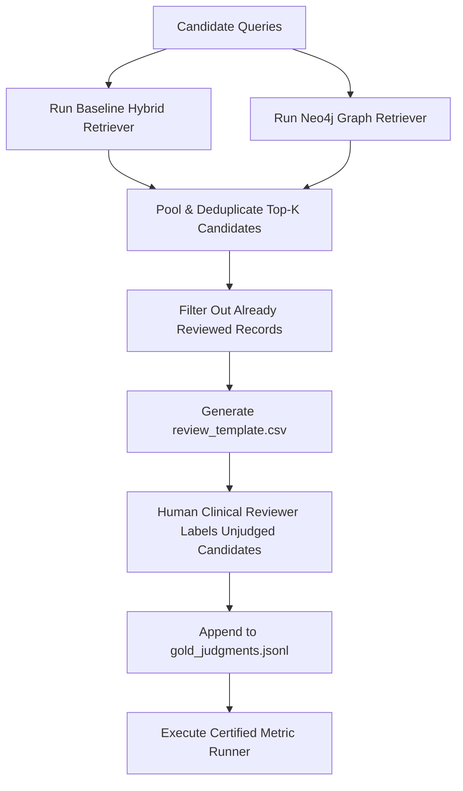

# MediScanAI — Metric Contract & Evaluation Specification

## 1. Scope & Execution Principles

This contract establishes the formal mathematical definitions, eligibility constraints, deduplication rules, and aggregation logic to be consumed by the evaluation runner in subsequent phases.

### Core Principles
1. **Retrieval First:** Retrieval quality is measured directly against source records, completely decoupled from downstream LLM generation or LLM-as-a-judge scoring.
2. **Deterministic Evaluation:** Given fixed retriever outputs and reviewed gold judgments, metrics must compute deterministically with zero variance.
3. **Traceable Evidence:** Every retrieved item is resolved to a stable composite `evidence_id` (`drug_<source_id>` or `disease_chunk_<chunk_id>`).
4. **Honest Incompleteness:** Unjudged retrieved candidates must never be silently assumed irrelevant (grade 0). Provisional scores must be distinguished from official certified scores.

---

## 2. Relevance Mapping & Thresholds

Human judgments use a 4-point ordinal scale $\{0, 1, 2, 3\}$. For set-based and rank-based evaluation metrics, the ordinal scale is mapped to binary relevance:

### Primary Operational Threshold (Default)
$$\text{Rel}(e) = \begin{cases} 1 & \text{if } \text{Grade}(e) \ge 2 \quad (\text{Directly Relevant or Relevant Supporting}) \\ 0 & \text{if } \text{Grade}(e) \le 1 \quad (\text{Weakly Related or Irrelevant}) \end{cases}$$

### Strict Clinical Threshold (Sensitivity Analysis)
$$\text{Rel}_{\text{strict}}(e) = \begin{cases} 1 & \text{if } \text{Grade}(e) = 3 \quad (\text{Directly Relevant only}) \\ 0 & \text{if } \text{Grade}(e) \le 2 \end{cases}$$

All metric calculations must report under the Primary Threshold by default, with option to output Strict Threshold metrics for sensitivity analysis.

---

## 3. Mathematical Metric Definitions

Let:
- $Q$ be the set of evaluation queries.
- $R_K(q) = [e_1, e_2, \dots, e_k]$ be the ordered list of top-$K$ retrieved evidence items for query $q$, deduplicated by `evidence_id`.
- $G(q) = \{e \in \text{Gold} : \text{Rel}(e) = 1\}$ be the set of reviewed relevant evidence for query $q$.
- $K \in \{1, 3, 5, 10\}$.

### 3.1 Recall@K
Measures the fraction of known relevant gold evidence retrieved within the top $K$ results:

$$\text{Recall@K}(q) = \begin{cases} \frac{|R_K(q) \cap G(q)|}{|G(q)|} & \text{if } |G(q)| > 0 \\ \text{UNDEFINED (Ineligible)} & \text{if } |G(q)| = 0 \end{cases}$$

$$\text{Macro-Recall@K} = \frac{1}{|Q_{\text{eligible}}|} \sum_{q \in Q_{\text{eligible}}} \text{Recall@K}(q)$$

**Eligibility Rule:** Queries with $|G(q)| = 0$ (such as unanswerable or out-of-scope negative controls) are strictly ineligible for Recall@K and must be excluded from the denominator $|Q_{\text{eligible}}|$.

### 3.2 Precision@K
Measures the proportion of retrieved items in the top $K$ that are relevant:

$$\text{Precision@K}(q) = \frac{|\{e \in R_K(q) : \text{Rel}(e) = 1\}|}{K}$$

$$\text{Macro-Precision@K} = \frac{1}{|Q|} \sum_{q \in Q} \text{Precision@K}(q)$$

**Boundary Rules:**
- If the retriever returns fewer than $K$ results ($m < K$), the denominator remains $K$ (standard information retrieval cutoff).
- Duplicate records appearing multiple times in the top $K$ must be collapsed to their first appearance before calculating $R_K(q)$.
- Retrieved items that do not exist in the gold dataset during provisional evaluation must be flagged as `unjudged_candidate` and reported in the pooling queue.

### 3.3 Mean Reciprocal Rank (MRR)
Measures the reciprocal rank of the first relevant document:

$$\text{RR}(q) = \begin{cases} \frac{1}{\text{rank}_1(q)} & \text{if } \exists e \in R_K(q) \text{ such that } \text{Rel}(e) = 1 \\ 0 & \text{if no relevant item is retrieved in top-}K \end{cases}$$

where $\text{rank}_1(q) \in \{1, 2, \dots, K\}$ is the 1-based index of the highest-ranked relevant item.

$$\text{MRR} = \frac{1}{|Q_{\text{eligible}}|} \sum_{q \in Q_{\text{eligible}}} \text{RR}(q)$$

**Eligibility Rule:** Only queries with $|G(q)| > 0$ are included in MRR calculation.

---

## 4. Graph-Added Evidence Coverage & ON/OFF Comparison

A core objective of MediScanAI is to quantify the exact marginal contribution of Neo4j graph retrieval over the baseline hybrid pipeline (dense FAISS + BM25 + Cross-Encoder reranker).

### 4.1 Input Evidence Sets
For query $q$:
- $E_{\text{base}}(q)$: Deduplicated set of retrieved evidence items from baseline pipeline (`NEO4J_ENABLED=false`).
- $E_{\text{graph}}(q)$: Deduplicated set of retrieved evidence items from standalone or integrated graph retrieval (`NEO4J_ENABLED=true`).
- Provenance filter: $E_{\text{graph\_valid}}(q) = \{e \in E_{\text{graph}}(q) : \text{source\_record\_id is verifiable in source JSONL}\}$.

### 4.2 Truly New Relevant Evidence Set
$$\Delta E_{\text{new\_rel}}(q) = \{e \in E_{\text{graph\_valid}}(q) \setminus E_{\text{base}}(q) : \text{Rel}(e) = 1\}$$

### 4.3 Graph Marginal Metrics
1. **Graph-Added Evidence Coverage:**
   $$\text{Coverage}_{\text{graph\_added}}(q) = \begin{cases} \frac{|\Delta E_{\text{new\_rel}}(q)|}{|G(q)|} & \text{if } |G(q)| > 0 \\ 0 & \text{if } |G(q)| = 0 \end{cases}$$

2. **Graph Redundancy Rate:**
   Measures the fraction of graph-retrieved items that merely duplicated baseline evidence already retrieved:
   $$\text{Redundancy}_{\text{graph}}(q) = \begin{cases} \frac{|E_{\text{graph}}(q) \cap E_{\text{base}}(q)|}{|E_{\text{graph}}(q)|} & \text{if } |E_{\text{graph}}(q)| > 0 \\ 0 & \text{if } |E_{\text{graph}}(q)| = 0 \end{cases}$$

3. **Graph Noise Rate:**
   Measures the fraction of graph-retrieved items that are irrelevant ($\text{Rel}(e) = 0$):
   $$\text{Noise}_{\text{graph}}(q) = \begin{cases} \frac{|\{e \in E_{\text{graph}}(q) : \text{Rel}(e) = 0\}|}{|E_{\text{graph}}(q)|} & \text{if } |E_{\text{graph}}(q)| > 0 \\ 0 & \text{if } |E_{\text{graph}}(q)| = 0 \end{cases}$$

**Ranking Prohibition:** Supplementary graph evidence must not be assigned synthetic top ranks unless the production pipeline implements an explicit unified score fusion.

---

## 5. Unanswerable & Negative Control Queries

Queries in category `insufficient_evidence_unanswerable` test system robustness against false positives and hallucinations.

For these queries, $G(q) = \emptyset$.
- **False Positive Count at K:** $\text{FP@K}(q) = |R_K(q)|$.
- **Zero-Retrieval / Rejection Accuracy:**
  $$\text{RejectionAccuracy}(q) = \begin{cases} 1 & \text{if } R_K(q) = \emptyset \text{ or all } e \in R_K(q) \text{ are marked unsupported} \\ 0 & \text{otherwise} \end{cases}$$

These cases must be reported in a dedicated "Negative Controls / Rejection Performance" table and never averaged into standard Recall@K.

---

## 6. Pooling Protocol (Preventing Incomplete-Ground-Truth Bias)

To prevent incomplete-ground-truth bias (where a retriever is penalized for retrieving valid documents omitted during initial query construction):

### 6.1 High-Cardinality Entity Pooling Specification (Case: MED-BENCH-036 `Metformin`)

In `candidate_queries.jsonl`, `MED-BENCH-036` (`query: "Metformin"`, category: `ambiguous_queries`) currently links to a single representative candidate `drug_345` (`Metformin Hydrochloride`). However, `data/drugs_faiss_data.jsonl` contains hundreds of distinct valid Metformin formulations across diverse manufacturers, strengths (e.g., 500mg, 850mg, 1000mg, extended-release), and combinations. Evaluating retrieval against only `drug_345` would induce severe **incomplete-ground-truth bias**.

Phase B will execute the following dedicated pooling procedure for `MED-BENCH-036`:

1. **Multi-Channel Retrieval Execution (Pool Collection):**
   - **Baseline Hybrid:** Query dense FAISS index ($K=10$), query BM25 index ($K=10$), fuse via RRF, and rerank via Cross-Encoder to produce top-$K$ baseline candidates $R_{\text{base}}$.
   - **Graph Traversal:** Query standalone Neo4j graph retriever via `find_drugs_by_name("Metformin", limit=10)` and `find_drugs_by_ingredient("METFORMIN", limit=10)` to produce graph candidates $R_{\text{graph}}$.
2. **Stable Evidence Deduplication:**
   - Map all retrieved items to composite evidence ID `drug_<source_record_id>`.
   - Form unified deduplicated candidate pool: $E_{\text{pool}}(\text{MED-BENCH-036}) = R_{\text{base}} \cup R_{\text{graph}}$.
3. **Source Provenance Retention:**
   - Every pooled candidate record preserves:
     - `source_record_id` (verifiable integer ID in `data/drugs_faiss_data.jsonl`).
     - `evidence_id` (`drug_<source_record_id>`).
     - `brand_name`, `generic_name`, and `substance_name`.
     - `retrieval_channels`: Bitmask/list indicating channel provenance (e.g., `["dense_faiss", "bm25", "graph_ingredient"]`).
4. **Relevance Grading Rubric for Pooled Metformin Records:**
   - **Grade 3 (Directly Relevant):** Any product where `substance_name` contains `"METFORMIN"` or `"METFORMIN HYDROCHLORIDE"` as a single active agent.
   - **Grade 2 (Relevant Supporting):** Fixed-dose combination products containing Metformin with another active ingredient (e.g., Metformin + Glipizide, Metformin + Sitagliptin).
   - **Grade 0 (Not Relevant):** Spurious lexical matches or unrelated chemical entities.
5. **Certification Requirement:** Official Recall@K and Precision@K for `MED-BENCH-036` may only be reported after all items in $E_{\text{pool}}$ are graded and promoted to `gold_judgments.jsonl`.

---

## 7. Data Quality & Benchmark Integrity Invariants

Before any evaluation run, the benchmark runner must enforce:
1. `case_id` uniqueness in `candidate_queries.jsonl`.
2. Composite `(case_id, evidence_id)` uniqueness in judgment files.
3. Strict enum validation for `query_category` and `evidence_type`.
4. Grade range validation: $\text{relevance_grade} \in \{0, 1, 2, 3\}$.
5. Source resolution: each `source_record_id` must resolve to an exact line in `data/drugs_faiss_data.jsonl` or `data/diseases_faiss_data.jsonl`.
6. Candidate vs. Gold separation: `gold_judgments.jsonl` must contain only rows with `judgment_status == "human_reviewed"`, non-null `reviewer_id`, and non-null `reviewed_at`.
