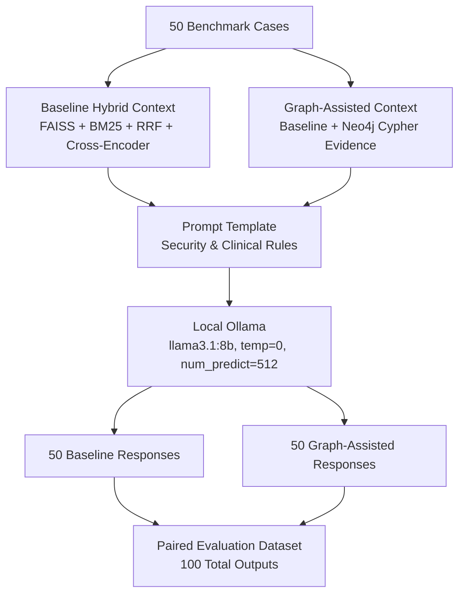

# Phase C.4 — Paired Baseline vs Graph-Assisted Answer Generation

**Directory:** `evaluation/ragas/phase_c_4/`  
**Purpose:** Stores the frozen, reproducible set of 100 paired clinical answers generated from MediScanAI's 50-case benchmark, comparing baseline hybrid retrieval against baseline plus Neo4j graph-assisted retrieval.  
**Generator Model:** `llama3.1:8b` (local Ollama runtime, digest `46e0c10c039e019119339687c3c1757cc81b9da49709a3b3924863ba87ca666e`)  
**Generation Settings:** `temperature: 0.0`, `num_predict: 512`, `top_p: 1.0`

---

## 1. Directory Manifest

| File | Description | Records |
| :--- | :--- | :---: |
| `run_manifest.json` | Execution metadata, model digest, prompt hash, settings, and aggregate metrics. | 1 JSON |
| `retrieval_contexts.jsonl` | Exact evidence text, composite source IDs, ranks, and SHA-256 hashes for both conditions. | 100 records |
| `generation_runs.jsonl` | Full per-attempt metadata, raw outputs, latencies, tokens, and compliance flags. | 100 records |
| `paired_responses.jsonl` | Baseline and graph-assisted outputs aligned case-by-case by canonical `case_id`. | 50 paired records |
| `warning_compliance.csv` | Header and disclaimer verification table with per-attempt compliance tracking. | 100 rows |
| `generation_failure_analysis.md` | Comprehensive analysis of negative controls, chest pain safety, and latency statistics. | Markdown |
| `integrity_report.json` | Machine-readable validation manifest confirming counts, hashes, and restrictions. | 1 JSON |
| `run_generation.py` | Standalone reproducible execution runner with dynamic progress bar and recovery logic. | Python |
| `progress.json` | Real-time progress monitoring output recording completed count, percentage, and ETA. | 1 JSON |
| `README.md` | This reproduction and documentation guide. | Markdown |

---

## 2. Experimental Design

The experiment isolates retrieval condition while strictly freezing the generator, query, and generation parameters:



### Retrieval Conditions:
1. **Baseline Hybrid Track (`condition: "baseline"`):**
   - Receives top-5 (or top-10 for ambiguous cases) fused items from Dense FAISS, BM25, and Cross-Encoder reranking.
   - Format: Bulleted list with composite evidence ID (`drug_<id>` or `disease_chunk_<id>`), rank, cross-encoder score, and excerpt.
2. **Graph-Assisted Track (`condition: "graph_assisted"`):**
   - Preserves 100% of the baseline evidence in identical order.
   - Appends supplementary graph evidence retrieved from Neo4j Cypher traversals (`channel: "graph"`).
   - If Neo4j yields zero candidates for a query, explicitly documents: `No additional graph evidence found.`

---

## 3. Key Results Summary

- **Total Generations:** 100 / 100 intended attempts completed successfully.
- **Failures / Retries:** 0 failures, 0 timeouts, 0 empty responses, 0 retries required.
- **Mandatory Warning Compliance:** 100/100 (100.0%) contain the required `### ⚠️ Important Warning` header and verbatim disclaimer text.
- **Negative Control Abstention:** 10/10 (100.0%) correctly identified unanswerable or absent evidence (including nonexistent drugs and fictitious syndromes).
- **Clinical Emergency Escalation:** `MED-BENCH-038` (`Chest pain`) appropriately emphasized immediate medical evaluation.
- **Execution Wall-Clock Time:** 1,903 seconds (~31m 42s).
- **Mean Generation Latency:** 19.0s (Baseline: 18.0s, Graph: 20.1s).
- **Tokens Generated:** Mean 169.7 tokens per response (Total: 16,972 tokens).

---

## 4. How to Reproduce

All dependencies are pinned in Conda environment `med-env`.

### Step 1: Ensure Ollama is running with `llama3.1:8b`
```bash
ollama run llama3.1:8b "Ready."
```

### Step 2: Execute Generation Runner
```bash
conda run -n med-env python -u evaluation/ragas/phase_c_4/run_generation.py
```

The script displays a live terminal progress bar:
```text
[=========================>] 100% | 100/100 | Track: graph_assisted | Case: MED-BENCH-050 (Tension Headache s...) | Elapsed: 31m 42s | ETA: 0s
```

---

## 5. Absolute Restrictions Observed

1. `entity_resolution/` was strictly off-limits: never inspected, read, searched, referenced, or modified.
2. `evaluation/benchmark/gold_judgments.jsonl` remains **strictly 0 bytes**.
3. No benchmark queries, judgments, or narrative references were modified.
4. No production code (`app/core.py`, `app/retriever.py`, etc.) or prompts were altered.
5. Zero external API calls were made; all generation used the local Ollama runtime.
6. Reference answers and relevance grades were never exposed to the generator.
7. All artifacts remain isolated under `evaluation/ragas/phase_c_4/`.
