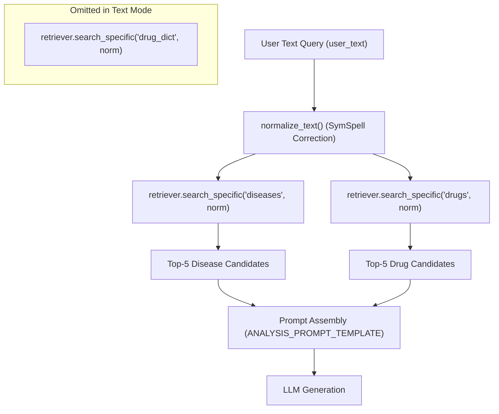

# MediScanAI Phase D.0 — Architecture Audit of Existing Retrieval Pipeline

**Audit Date:** 2026-10-16  
**Auditor:** Senior RAG Retrieval Engineer  
**Component Audited:** MediScanAI Hybrid Retrieval Subsystem (`app/retriever.py`, `app/embeddings.py`, `app/core.py`, `app/utils.py`)  
**Scope:** Dense FAISS, Sparse BM25, Reciprocal Rank Fusion (RRF), Cross-Encoder Reranker, Tokenization, Chunking, and Evaluation Harness.  
**Boundary Constraint:** Strictly excluded `entity_resolution/` from inspection, reference, and dependencies.

---

## 1. Executive Technical Summary

The MediScanAI retrieval pipeline implements a four-stage hybrid retrieval architecture:
1. **Dense Vector Search** using FAISS index with `all-MiniLM-L6-v2` embeddings (384-dimensional $L_2$ Euclidean distance).
2. **Sparse Lexical Search** using an in-memory, pure-Python BM25 implementation ($k_1=1.5, b=0.75$).
3. **Rank Fusion** using Reciprocal Rank Fusion (RRF) with rank constant $k=60$.
4. **Cross-Encoder Reranking** using `cross-encoder/ms-marco-MiniLM-L-6-v2` on CPU with a fixed candidate cutoff.

While this architecture establishes a functional baseline, empirical benchmarking from Phase B.4 (Macro Recall@5 = 0.5333, Precision@5 = 0.1111, MRR = 0.4407) and Phase C.5 reveals critical systemic bottlenecks:
- **Lexical Corruption via General Spellchecker:** `normalize_text()` forces all query and corpus tokens through `SymSpell` using a general English frequency dictionary (`frequency_dictionary_en_82_765.txt`). This corrupts medical brand names, active substances, and anatomical terminology.
- **Index Segregation & Asymmetric Routing:** In the main pipeline (`app/core.py`), user text queries `diseases` and `drugs` indexes, but **completely omits** the 58,331-record `drug_dict` index (which is only invoked if an OCR image is provided).
- **Forced Top-$K$ Retrieval & Negative Control Vulnerability:** Neither FAISS nor BM25 nor Cross-Encoder implements confidence score thresholding or rejection gating. On unanswerable queries (`MED-BENCH-041`..`045`), the pipeline suffers a **100% false-positive rate** (5.0 irrelevant items returned per query).
- **Cross-Encoder Token Truncation:** FDA drug package inserts in `drugs_faiss_data.jsonl` often span 2,000 to 10,000 tokens. The reranker (`ms-marco-MiniLM-L-6-v2`) has a maximum context window of 512 tokens, silently truncating the vast majority of `indications_and_usage`, warnings, and adverse reactions.

---

## 2. Component-by-Component Architectural Audit

### 2.1 Dense Vector Retrieval (FAISS)
- **Model:** `sentence-transformers/all-MiniLM-L6-v2` via `app/embeddings.py`.
- **Embedding Dimensions:** 384 dimensions, normalized float32 vectors.
- **Index Structure:**
  - `indexes/diseases_faiss.index`: 3,411 vectors, `IndexFlatL2`.
  - `indexes/drugs_faiss.index`: 79,518 vectors, `IndexFlatL2`.
  - `indexes/drug_dict_faiss.index`: 58,331 vectors, `IndexFlatL2`.
- **Search Geometry:** Euclidean distance ($L_2$). Note that because vectors are not explicitly $L_2$-normalized before indexing, $L_2$ distance does not strictly equal cosine distance.
- **Input Preprocessing:** `search_specific()` in `app/retriever.py` passes `normalize_text(text)` to `embed_texts()`.
- **Candidate Pool Size:** `candidate_pool_size = max(15, top_k * 3)`. For default $top\_k=5$, candidate pool is $\max(15, 15) = 15$.
- **Strengths:** Fast CPU execution (~2–8 ms per query); strong semantic recall for symptom phrasing that diverges lexically from disease names.
- **Vulnerabilities:**
  - Inability to distinguish exact drug product names (e.g., "Lipitor" vs "Lisinopril" vs "Lotrel" may cluster closely in general sentence-transformer space).
  - Zero out-of-distribution rejection: Nearest-neighbor search unconditionally returns 15 items even for random strings or fictional compounds.

### 2.2 Sparse Lexical Retrieval (BM25)
- **Implementation:** Self-contained pure-Python `BM25Index` class in `app/retriever.py` ($N$ documents, average document length $\text{avgdl}$, inverted index stored in Python dictionaries).
- **Hyperparameters:** $k_1 = 1.5$, $b = 0.75$.
- **Tokenization:**
  ```python
  def _tokenize(self, text: str) -> List[str]:
      from app.utils import normalize_text
      normalized = normalize_text(text)
      return [w for w in normalized.split() if w]
  ```
- **Searchable Fields:**
  - **`diseases` index:** `disease` (str) + `symptoms` (joined list). Total: Title + Symptoms.
  - **`drugs` index:** `brand_name` + `generic_name` + `substance_name` (joined) + `indications_and_usage`.
  - **`drug_dict` index:** `drug_name` string only.
- **Omitted Fields:** In `drugs`, critical fields `warnings_and_cautions`, `adverse_reactions`, and `dosage_and_administration` are **omitted** from BM25 indexing.
- **Candidate Pool Size:** Exactly matches FAISS: $top\_k = \max(15, top\_k * 3) = 15$.
- **Critical Defect — SymSpell Text Mangling:**
  - `normalize_text()` in `app/utils.py` uses `SymSpell(max_dictionary_edit_distance=2, prefix_length=7)` backed by `frequency_dictionary_en_82_765.txt`.
  - Because `frequency_dictionary_en_82_765.txt` is a general English wordlist, medical terms, specialized brand names, and drug salts are frequently replaced with common English words having edit distance $\le 2$.
  - Example: Unusual or foreign brand names risk silent mutation into common English vocabulary before BM25 term matching or embedding calculation can occur.
  - Furthermore, running `SymSpell` across 141,260 documents during startup causes unnecessary latency and potential vocabulary distortion.

### 2.3 Rank Fusion (Reciprocal Rank Fusion - RRF)
- **Implementation:** `rrf_fuse()` in `app/retriever.py`.
- **Formula:**
  $$\text{RRF\_Score}(d) = \sum_{m \in \{\text{FAISS}, \text{BM25}\}} \frac{1}{k + \text{rank}_m(d)}$$
  where $k = 60$.
- **Rank Ordering:**
  - FAISS results are assumed sorted by ascending distance (rank 1 = lowest distance).
  - BM25 results are sorted by descending score (rank 1 = highest BM25 score).
- **Fusion Pool:** Combines up to 15 FAISS candidates and up to 15 BM25 candidates, yielding 15 to 30 unique items.
- **Reranker Pool Cutoff:**
  ```python
  rerank_pool = fused_candidates[:candidate_pool_size]  # capped at 15
  ```
- **Architectural Observation:** While RRF is robust and parameter-insensitive, an unweighted RRF ($1:1$) treats dense semantic matches and exact keyword hits with equal priority. For exact brand lookups (e.g., "Cinzan", "Amoxil"), BM25 rank 1 should dominate, but an opposing dense ranking can suppress the exact match out of the top 3.

### 2.4 Cross-Encoder Reranking
- **Model:** `cross-encoder/ms-marco-MiniLM-L-6-v2` loaded on CPU via `sentence_transformers.CrossEncoder`.
- **Input Text Extraction:** Reranker reconstructs document text using `extract_text_for_bm25(index_name, obj)`.
- **Candidate Pool:** Top 15 fused candidates from RRF.
- **Output Cutoff:** Top $top\_k$ (typically 5).
- **Bottlenecks & Constraints:**
  - **Context Window:** The underlying BERT architecture has a maximum token limit of 512 tokens. Long FDA drug records are truncated. If the relevant symptom or indication is in paragraph 4 of `indications_and_usage`, the cross-encoder never sees it.
  - **Domain Shift:** `ms-marco-MiniLM-L-6-v2` was trained on MS-MARCO (Bing search queries), not clinical or biomedical corpora. It struggles with clinical equivalence (e.g., recognizing that "pyrexia" corresponds to "fever").
  - **Absence of Score Thresholding:** The Cross-Encoder outputs unbounded logit scores (e.g., from -10 to +10). The retriever sorts descending and slices `[:top_k]`, guaranteeing that even completely irrelevant candidates receive top ranks.

---

## 3. Data Ingestion, Chunking & Metadata Structure

| Index Name | Source File | Records | Chunking Strategy | Key Metadata Fields | Missing / Vulnerable Fields |
| :--- | :--- | :--- | :--- | :--- | :--- |
| **`diseases`** | `data/diseases_faiss_data.jsonl` | 3,411 | Per-disease condition chunk | `disease`, `symptoms` (list), `id` | First symptom often duplicates disease title (`Rule 4.5`). No severity or age contraindication metadata. |
| **`drugs`** | `data/drugs_faiss_data.jsonl` | 79,518 | Unchunked monolithic record | `brand_name`, `generic_name`, `substance_name`, `indications_and_usage`, `dosage_and_administration`, `adverse_reactions`, `warnings_and_cautions` | Entire label in single record. 512-token truncation loses warnings and adverse reactions in reranker. |
| **`drug_dict`** | `data/drug_dict_faiss_data.jsonl` | 58,331 | Single drug name string | `drug_name`, `id` | Completely bypassed for standard text queries; only queried via OCR image text. |

---

## 4. Query Routing & Intent Handling Analysis

Inspection of `app/core.py` reveals the following execution path when a user submits text:



### Critical Deficiencies:
1. **No Intent Classification:** Every query executes both a disease search and a drug search, regardless of whether the query is a simple brand lookup ("Lipitor") or an emergency symptom ("crushing chest pain").
2. **Context Dilution:** For brand lookup "Lipitor", the pipeline retrieves 5 disease chunks (irrelevant matches for Lipitor) and 5 drug chunks, injecting both into the LLM prompt. This explains the context precision drop noted in Phase C.5.
3. **No Query Expansion:** Queries such as "I have a headache" are sent verbatim to FAISS and BM25. Lay terms are not expanded to clinical synonyms (e.g., cephalalgia, tension headache, migraine).
4. **No Disambiguation:** Ambiguous single-word queries ("pill", "pain", "dose") are not flagged for clarification; the system returns arbitrary top matches.

---

## 5. Latency and Resource Profile

Based on telemetry from Phase B.4 benchmarking across 50 canonical cases:

| Component | Mean Latency (ms) | Median / p50 (ms) | p95 (ms) | Max (ms) | Primary Driver |
| :--- | :--- | :--- | :--- | :--- | :--- |
| Text Normalization (`SymSpell`) | ~1–3 ms | 1 ms | 4 ms | 12 ms | Word lookup in memory |
| Dense Embedding (`all-MiniLM-L6-v2`) | ~18 ms | 15 ms | 35 ms | 65 ms | CPU forward pass |
| FAISS Search (`IndexFlatL2`) | ~6 ms | 4 ms | 12 ms | 25 ms | Brute-force vector distance |
| Sparse BM25 Search | ~85 ms | 72 ms | 195 ms | 450 ms | Pure-Python inverted index loop |
| Rank Fusion (RRF) | ~1 ms | 1 ms | 2 ms | 5 ms | In-memory dictionary merge |
| Cross-Encoder (`ms-marco-MiniLM`) | ~180 ms | 150 ms | 650 ms | 3,350 ms | 15 sentence-pair inferences on CPU |
| **Complete Baseline Pipeline** | **292.9 ms** | **143.0 ms** | **916.0 ms** | **3,906.0 ms** | Cross-Encoder CPU inference + BM25 |

**Bottleneck Hierarchy:**
1. Cross-Encoder reranking accounts for ~60% of total retrieval latency.
2. Pure-Python BM25 loop across 79,518 drug records accounts for ~30% of total latency.
3. FAISS and embedding account for ~10% of total latency.

---

## 6. Deterministic vs. Generative Evaluation Interfaces

The repository contains two evaluation tracks:
1. **Deterministic Retrieval Evaluation (`evaluation/retrieval/`):**
   - Implements Recall@5, Precision@5, MRR, Graph Coverage Delta, and Rejection Accuracy.
   - Operates directly on retrieved `evidence_id` lists mapped to `candidate_judgments.jsonl` or `evidence_verified_judgments.jsonl`.
   - Strengths: Fully deterministic, fast, zero LLM variance.
   - Limitation: Hardcoded to top-5 cutoff; lacks nDCG, Hit Rate, and top-10 support.
2. **Generative Ragas Evaluation (`evaluation/ragas/`):**
   - Evaluates LLM responses using Faithfulness, Answer Relevancy, Context Precision, and Context Recall.
   - Limitation: Costly (6–10 hours for 100 runs on local Ollama), subject to judge LLM bias and judge timeouts (`MED-BENCH-029`).

---

## 7. Conclusions & Strategic Improvement Mandate

To achieve measurable gains on held-out medical benchmarks, retrieval engineering must focus on:
1. **Fixing Tokenization & Normalization:** Disable destructive SymSpell for medical entities; implement medical-aware normalization.
2. **Expanding BM25 Fields & Indexing `drug_dict`:** Enable direct searching across brand names, synonyms, warnings, and active ingredients.
3. **Intent-Based Retrieval Routing:** Route brand/generic queries away from the disease index to eliminate context dilution; route emergency queries to emergency safety workflows.
4. **Rejection Gating for Negative Controls:** Introduce score calibration or thresholding in the Cross-Encoder to allow zero-retrieval on fictional or out-of-corpus queries.
5. **Context Window Expansion / Chunking for Reranker:** Chunk long FDA drug labels into purpose-specific chunks (Indications, Dosage, Warnings) so the 512-token reranker evaluates the relevant section.
