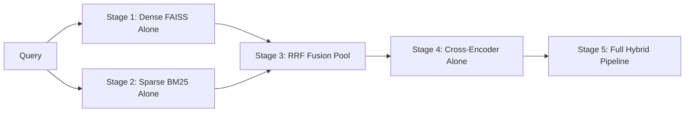

# MediScanAI Phase D.0 — Deterministic Retrieval Metric Contract & Evaluation Interface Specification

**Contract Version:** 2.0.0 (Phase D.0 Expansion)  
**Date:** 2026-10-16  
**Auditor / Author:** Senior RAG Retrieval Engineer  
**Target Subsystems:** Dense FAISS, Sparse BM25, RRF Fusion, Cross-Encoder Reranker, Hybrid Pipeline  
**Compliance Standard:** Decoupled Deterministic IR Evaluation (zero LLM-as-a-judge dependency for retrieval metrics)

---

## 1. Scope, Objectives & Provenance Isolation Rules

This contract establishes the formal mathematical definitions, deduplication invariants, eligibility rules, and stratification boundaries for evaluating the MediScanAI hybrid retrieval pipeline.

### 1.1 Strict Provenance Isolation
1. **Certified Gold Isolation:** `evaluation/benchmark/gold_judgments.jsonl` remains strictly **0 bytes**. No official certified human gold benchmark exists in the repository.
2. **Provisional Adjudication Track:** All deterministic retrieval benchmarks in Phase D must execute under the explicit label:
   ```json
   "evaluation_track": "ai_assisted_evidence_verified_provisional",
   "certified_human_gold": false
   ```
   Ground truth judgments are consumed exclusively from the evidence-verified judgment store (`evidence_verified_judgments.jsonl`), wherein every relevance label is linked to verified external medical literature (DailyMed/FDA, NIH, CDC, WHO).
3. **Honest Incompleteness (No Silent Zero-Filling):** Retrieved items that lack a judgment in the evaluation dataset are marked `UNJUDGED_CANDIDATE`. They must **NEVER** be converted to Grade 0 (Irrelevant). Queries with zero known relevant gold items are excluded from Recall, Hit Rate, MRR, and nDCG denominators.
4. **Data Leakage & Split Integrity:**
   - **Hyperparameter Tuning Split (Dev/Val):** Hyperparameters ($k_1, b$, RRF $k$, dense top-$k$, reranker candidate cutoff) may only be tuned on the development split (60%) and validation split (20%).
   - **Held-Out Test Split (20%):** Evaluated strictly once per approved experiment. **Hyperparameter tuning against the held-out test split is strictly forbidden.**

---

## 2. Canonical Document Identifiers & Evidence Mapping

Every candidate record returned by any retriever must be resolved to a canonical composite `evidence_id`:

| Index Domain | Source File | Record ID Field | Canonical Evidence ID Syntax | Canonical Document Example |
| :--- | :--- | :--- | :--- | :--- |
| **`drugs`** | `data/drugs_faiss_data.jsonl` | `id` (int) | `drug_<id>` | `drug_53548` (Lipitor 10mg) |
| **`diseases`** | `data/diseases_faiss_data.jsonl` | `chunk.id` (str) | `disease_chunk_<chunk_id>` | `disease_chunk_chunk_3001` (PCOS) |
| **`drug_dict`** | `data/drug_dict_faiss_data.jsonl`| `id` (int) | `drug_dict_<id>` | `drug_dict_1` (amlodipine) |

### 2.1 Deduplication & Rank-Tie Resolution
- **Deduplication:** If an index or fusion stage produces duplicate records with the same canonical `evidence_id`, the duplicate appearing at the lower rank is dropped. The list is compacted while preserving the original relative order of distinct IDs.
- **Rank Ties:** When two candidates have identical scores (e.g., identical BM25 scores or identical RRF values), tie-breaking is deterministic:
  $$\text{Sort Key} = (-\text{score}, \text{evidence\_id})$$
  lexicographically ascending by canonical string identifier.

---

## 3. Graded Relevance Rubric & Binarization Mappings

Judgments utilize a 4-point ordinal scale $\{0, 1, 2, 3\}$:
- **Grade 3 (Directly Relevant):** Substantially answers the primary retrieval task with direct factual support.
- **Grade 2 (Relevant Supporting):** Valid supporting context (e.g., generic alternative, multi-ingredient partner, related differential pathology).
- **Grade 1 (Weakly Related):** Peripheral mention without clinical utility.
- **Grade 0 (Not Relevant):** Irrelevant, erroneous, or spurious match.

### 3.1 Binarization Thresholds for Set & Rank Metrics
- **Primary Operational Threshold (Default):**
  $$\text{Rel}_{\text{primary}}(e) = \begin{cases} 1 & \text{if } \text{Grade}(e) \ge 2 \\ 0 & \text{if } \text{Grade}(e) \le 1 \end{cases}$$
- **Strict Clinical Threshold (Sensitivity Analysis):**
  $$\text{Rel}_{\text{strict}}(e) = \begin{cases} 1 & \text{if } \text{Grade}(e) = 3 \\ 0 & \text{if } \text{Grade}(e) \le 2 \end{cases}$$

---

## 4. Mathematical Definitions of Evaluated Metrics

Let:
- $Q$ be the set of benchmark queries.
- $R_K(q) = [e_1, e_2, \dots, e_K]$ be the deduplicated, ordered list of top-$K$ retrieved evidence items for query $q$.
- $G(q) = \{e \in \text{Judgments}(q) : \text{Rel}(e) = 1\}$ be the set of verified relevant evidence items for $q$.
- $K \in \{5, 10\}$.

### 4.1 Recall@K
Measures the proportion of known relevant evidence items retrieved within the top $K$:

$$\text{Recall@K}(q) = \begin{cases} \frac{|R_K(q) \cap G(q)|}{|G(q)|} & \text{if } |G(q)| > 0 \\ \text{Ineligible (Excluded)} & \text{if } |G(q)| = 0 \end{cases}$$

$$\text{Macro-Recall@K} = \frac{1}{|Q_{\text{eligible}}|} \sum_{q \in Q_{\text{eligible}}} \text{Recall@K}(q)$$

### 4.2 Hit Rate@K (Success@K)
Measures whether at least one relevant evidence item was retrieved within the top $K$:

$$\text{Hit@K}(q) = \begin{cases} 1 & \text{if } |R_K(q) \cap G(q)| \ge 1 \\ 0 & \text{if } |R_K(q) \cap G(q)| = 0 \\ \text{Ineligible (Excluded)} & \text{if } |G(q)| = 0 \end{cases}$$

$$\text{Macro-HitRate@K} = \frac{1}{|Q_{\text{eligible}}|} \sum_{q \in Q_{\text{eligible}}} \text{Hit@K}(q)$$

### 4.3 Mean Reciprocal Rank@K (MRR@K)
Measures the reciprocal rank of the first relevant document in the top $K$:

$$\text{RR@K}(q) = \begin{cases} \frac{1}{\min \{i \in \{1,\dots,K\} : e_i \in G(q)\}} & \text{if } \exists e_i \in R_K(q) \cap G(q) \\ 0.0 & \text{if no relevant item in top-}K \\ \text{Ineligible (Excluded)} & \text{if } |G(q)| = 0 \end{cases}$$

$$\text{MRR@K} = \frac{1}{|Q_{\text{eligible}}|} \sum_{q \in Q_{\text{eligible}}} \text{RR@K}(q)$$

### 4.4 Normalized Discounted Cumulative Gain@10 (nDCG@10)
Measures ranking quality using graded relevance $\{0, 1, 2, 3\}$.

#### Discounted Cumulative Gain (DCG@10):
$$\text{DCG@10}(q) = \sum_{i=1}^{\min(10, |R(q)|)} \frac{2^{\text{Grade}(e_i)} - 1}{\log_2(i + 1)}$$

#### Ideal Discounted Cumulative Gain (IDCG@10):
Let $G^*(q)$ be the list of all judged items for query $q$, sorted descending by $\text{Grade}(e)$:
$$\text{IDCG@10}(q) = \sum_{i=1}^{\min(10, |G^*(q)|)} \frac{2^{\text{Grade}(e_i^*)} - 1}{\log_2(i + 1)}$$

#### Normalized DCG:
$$\text{nDCG@10}(q) = \begin{cases} \frac{\text{DCG@10}(q)}{\text{IDCG@10}(q)} & \text{if } \text{IDCG@10}(q) > 0 \\ \text{Ineligible (Excluded)} & \text{if } \text{IDCG@10}(q) = 0 \end{cases}$$

$$\text{Macro-nDCG@10} = \frac{1}{|Q_{\text{eligible}}|} \sum_{q \in Q_{\text{eligible}}} \text{nDCG@10}(q)$$

### 4.5 Negative Control & Rejection Metrics
For negative control queries ($|G(q)| = 0$, where expected evidence is $\emptyset$):
- **False Positive Count@K:** $\text{FP@K}(q) = |R_K(q)|$ (every retrieved item is an ungrounded hallucination).
- **Rejection Accuracy@K:**
  $$\text{RejectionAcc@K}(q) = \begin{cases} 1.0 & \text{if } |R_K(q)| = 0 \\ 0.0 & \text{if } |R_K(q)| > 0 \end{cases}$$

---

## 5. Independent Component-Level Evaluation Interface

To isolate retrieval bottlenecks and prevent masking of component failures, the evaluation harness must report metrics independently for all five pipeline stages:



### Component Metric Matrix:

| Evaluation Stage | Input Candidate Source | Scoring Mechanism | Evaluated Metrics | Diagnostic Purpose |
| :--- | :--- | :--- | :--- | :--- |
| **1. Dense FAISS Alone** | Full FAISS Index | $L_2$ distance ascending | Recall@5, Recall@10, Hit Rate@5, MRR@10 | Measures semantic recall ceiling without lexical cues. |
| **2. Sparse BM25 Alone** | Full BM25 Index | BM25 score descending | Recall@5, Recall@10, Hit Rate@5, MRR@10 | Measures exact keyword and brand matching power. |
| **3. RRF Fusion Alone** | Top-15 FAISS + Top-15 BM25 | RRF score descending ($k=60$) | Recall@10, Hit Rate@10, MRR@10 | Measures fusion quality prior to reranking. |
| **4. Cross-Encoder Alone** | Pre-selected candidate pool (e.g. Top-30) | Logit score descending | Recall@5, Hit Rate@5, MRR@10, nDCG@10 | Measures reranker capacity to promote relevant items to top ranks. |
| **5. Full Hybrid Pipeline** | Complete end-to-end | Integrated hybrid cutoff | Full suite: Recall@5/10, Hit@5/10, MRR@10, nDCG@10, Rejection Acc | Measures operational production performance. |

---

## 6. Denominator Accounting & Reporting Schema

For every reported evaluation run, the output summary JSON must explicitly log the denominator accounting table:

```json
{
  "total_queries_submitted": 50,
  "eligible_answerable_queries": 45,
  "excluded_unanswerable_negative_controls": 5,
  "excluded_missing_gold_judgments": 0,
  "metrics": {
    "macro_recall_at_5": 0.5333,
    "macro_recall_at_10": null,
    "macro_hit_rate_at_5": 0.6222,
    "macro_hit_rate_at_10": null,
    "macro_mrr_at_10": 0.4407,
    "macro_ndcg_at_10": null,
    "negative_control_rejection_accuracy_at_5": 0.0,
    "negative_control_false_positive_count_at_5": 5.0
  },
  "strata_eligibility": {
    "CAT-01-BRAND-LOOKUP": {"total": 5, "eligible": 5},
    "CAT-02-GENERIC-LOOKUP": {"total": 5, "eligible": 5},
    "CAT-11-UNANSWERABLE": {"total": 5, "eligible_recall": 0, "eligible_rejection": 5}
  }
}
```

---

## 7. Compliance Verification Checklist

Before accepting any retrieval evaluation run:
- [ ] `gold_judgments.jsonl` verified at exactly 0 bytes.
- [ ] No unjudged document coerced to Grade 0.
- [ ] Top-5 and Top-10 evaluated with identical candidate inputs.
- [ ] Deduplication executed prior to rank slicing.
- [ ] Ties broken deterministically by canonical `evidence_id`.
- [ ] Negative controls excluded from Recall/MRR/nDCG denominators.
- [ ] Component metrics calculated independently for FAISS, BM25, RRF, and Cross-Encoder.
