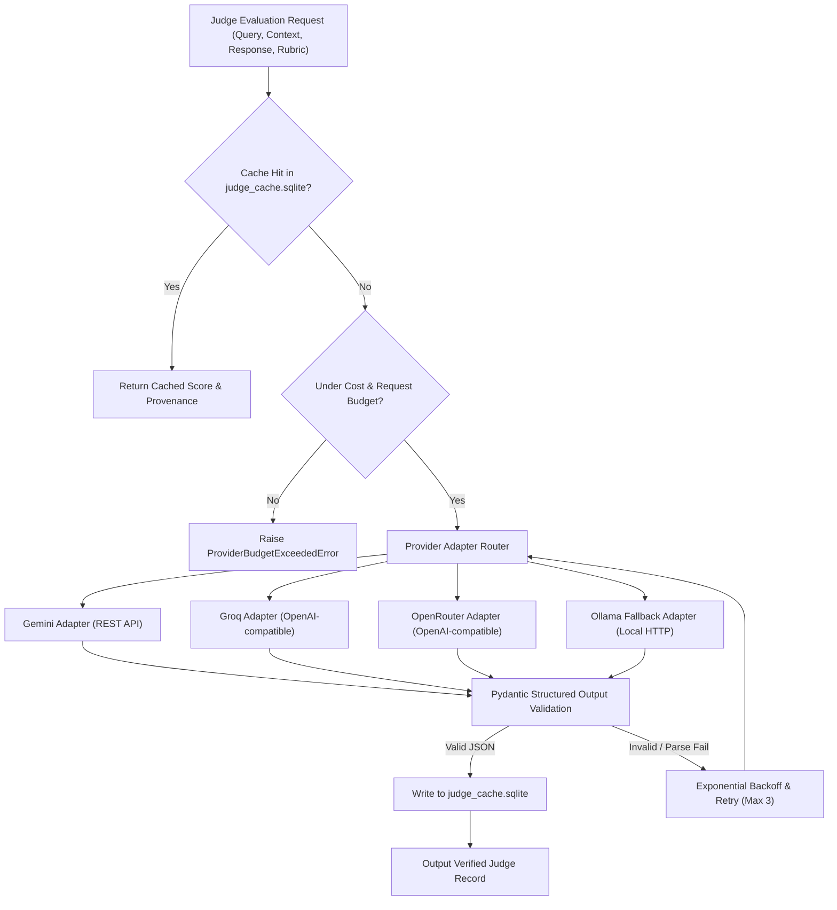

# MediScanAI Phase D.0 — Provider-Independent LLM Judge Architecture Specification

**Document Version:** 1.0.0  
**Phase:** Phase D.0 Design (Zero API calls or executions permitted in this phase)  
**Author:** Senior RAG Retrieval Engineer  
**Objective:** Specify a robust, multi-provider evaluation judge framework supporting Google Gemini, Groq, OpenRouter, and Local Ollama with strict provenance attribution, cost controls, and agreement calibration.

---

## 1. Architectural Principles & Security Boundary

1. **Zero Secret Exposure:** Configuration reads environment variables (`GEMINI_API_KEY`, `GROQ_API_KEY`, `OPENROUTER_API_KEY`, `OLLAMA_BASE_URL`). Secret values are **NEVER** printed, logged, stored in cache records, or serialized into reports.
2. **Provider Non-Equivalence Principle:** Different model families (e.g., Gemini 2.0 Flash vs Llama 3.3 70B vs Mistral) exhibit distinct rubric calibration, verbosity biases, and strictness thresholds. They must **NEVER** be silently pooled or aggregated as if interchangeable.
3. **Immutable Per-Score Attribution:** Every AI-assisted judge score must permanently record the exact provider, model version, temperature, prompt template hash, latency, and timestamp.
4. **Offline First & Cost Capping:** Local Ollama serves as the deterministic zero-cost baseline. Cloud providers are bounded by strict request quotas and financial spend caps.

---

## 2. Multi-Provider Interface Architecture



### 2.1 Provider Configuration Matrix

| Provider | Supported Production Models | Protocol | Auth Header / Parameter | Primary Use Case |
| :--- | :--- | :--- | :--- | :--- |
| **Google Gemini** | `gemini-2.0-flash`, `gemini-1.5-flash` | Google Generative Language REST v1beta | `?key=${GEMINI_API_KEY}` | High-speed multi-modal and long-context evaluation |
| **Groq** | `llama-3.3-70b-versatile`, `llama-3.1-8b-instant` | OpenAI-compatible REST (`/v1/chat/completions`) | `Authorization: Bearer ${GROQ_API_KEY}` | High-throughput low-latency open-weight inference |
| **OpenRouter** | `anthropic/claude-3.5-sonnet`, `meta-llama/llama-3.3-70b-instruct` | OpenAI-compatible REST (`/api/v1/chat/completions`) | `Authorization: Bearer ${OPENROUTER_API_KEY}` | Multi-model cross-vendor calibration |
| **Local Ollama** | `llama3.1:8b`, `mistral:latest` | Local Ollama REST (`/api/chat`) | None (Local socket `OLLAMA_BASE_URL`) | Zero-cost local baseline & air-gapped evaluation |

---

## 3. Structured Output Schema & Validation

All judge evaluations must return strictly parseable JSON conforming to the `JudgeEvaluationOutput` Pydantic model. If a provider returns markdown fences, thinking tokens, or free text, the output is passed through an automated JSON repair extractor before validation.

### 3.1 Target Output Schema

```json
{
  "metric_name": "faithfulness",
  "score": 0.8571,
  "verdict": "PARTIALLY_SUPPORTED",
  "binary_grade": 1,
  "reasoning_steps": [
    "Claim 1: 'Lipitor contains atorvastatin' is directly confirmed by context line 3.",
    "Claim 2: 'Take 500mg daily' is ungrounded in provided label context."
  ],
  "claims_evaluated_count": 2,
  "claims_supported_count": 1,
  "unsupported_claims": [
    "Take 500mg daily"
  ],
  "confidence_score": 0.95
}
```

### 3.2 Schema Enforcement Rules
- **Score Bounds:** Float strictly bounded in $[0.0, 1.0]$. Values outside this range immediately fail validation.
- **Verdict Enumeration:** Must be one of `["FULLY_SUPPORTED", "PARTIALLY_SUPPORTED", "UNSUPPORTED", "REFUTED", "NOT_APPLICABLE"]`.
- **Reasoning Mandate:** `reasoning_steps` must be a non-empty array of specific factual evaluations referencing the context.

---

## 4. Fault Tolerance, Rate Limiting & Backoff Strategy

To ensure zero benchmark disruption and graceful degradation across distributed API services:

1. **Concurrency Semaphores:**
   - Gemini: Max 5 concurrent requests.
   - Groq: Max 3 concurrent requests (to protect TPM rate tiers).
   - OpenRouter: Max 4 concurrent requests.
   - Ollama: Strict serial queue (Max 1 concurrent request on local GPU/CPU).
2. **Exponential Backoff with Full Jitter:**
   $$\text{Sleep Time} = \min\left(t_{\max}, t_{\text{base}} \times 2^{\text{attempt}}\right) \pm \text{Uniform}(0, \text{jitter})$$
   - $t_{\text{base}} = 1.0\text{s}$, $t_{\max} = 16.0\text{s}$, maximum attempts = 3.
3. **Specific HTTP Error Handling:**
   - **HTTP 429 (Rate Limit):** Inspect `Retry-After` header if present; backoff for $\max(\text{Retry-After}, 5.0\text{s})$.
   - **HTTP 500/502/503 (Upstream Outage):** Retry with backoff.
   - **HTTP 401/403 (Authentication Failure):** Immediately fail fast with `ProviderAuthenticationError`; **never retry**.
   - **Timeout Ceiling:** Client timeout hard-capped at 60.0s per request (`ONLINE_LLM_TIMEOUT_SECONDS`).

---

## 5. Cost Budgeting, Request Tracking & Quota Guardrails

Before initiating any evaluation run with cloud providers, an explicit quota budget must be provisioned in the runner:

```python
class ProviderBudget:
    max_total_requests: int = 500
    max_estimated_cost_usd: float = 2.00  # Hard spend ceiling
    current_requests: int = 0
    current_input_tokens: int = 0
    current_output_tokens: int = 0
    estimated_cost_usd: float = 0.0
```

### Quota Enforcement Rules:
- If `current_requests >= max_total_requests`, execution halts with `BudgetExceededException`.
- If `estimated_cost_usd >= max_estimated_cost_usd`, execution halts immediately.
- A dry-run estimation of token count must be calculated prior to launching batch runs.

---

## 6. Content-Addressable Response Caching & Reproducibility

To guarantee deterministic reproduction, avoid duplicate cloud spend, and prevent LLM non-determinism from corrupting comparative benchmarks:

### 6.1 Cache Key Generation
The cache key is computed as the SHA-256 hash of the canonicalized invocation payload:
$$\text{CacheKey} = \text{SHA-256}\left(\text{provider} + \text{model\_id} + \text{prompt\_template\_hash} + \text{input\_text} + \text{temperature} + \text{schema\_version}\right)$$

### 6.2 Cache Storage
- Backed by a local SQLite database: `evaluation/retrieval/cache/judge_cache.sqlite`.
- Stores raw response text, parsed JSON, input/output token counts, latency in ms, and creation timestamp.
- **Cache Invariant:** Identical evaluation inputs will return the cached evaluation without making external network calls.

---

## 7. Multi-Judge Calibration, Agreement Analysis & Stratification Policy

Before any cloud judge is trusted to score benchmark cases, a **Fixed Calibration Sample ($N=50$)** must be evaluated independently by all candidate judges.

### 7.1 Multi-Judge Agreement Evaluation Protocol
1. **Calibration Cohort:** 50 canonical queries across all 12 taxonomy categories.
2. **Evaluators:**
   - Judge A: Gemini 2.0 Flash (`gemini-2.0-flash`)
   - Judge B: Groq Llama 3.3 70B (`llama-3.3-70b-versatile`)
   - Judge C: Local Ollama Llama 3.1 8B (`llama3.1:8b`)
3. **Statistical Metrics Computed:**
   - **Cohen's Quadratic Weighted $\kappa$:** Evaluates pairwise ordinal agreement $\{0, 1, 2, 3\}$. Minimum acceptance threshold: $\kappa \ge 0.70$.
   - **Fleiss's $\kappa$:** Evaluates multi-judge inter-rater reliability across all 3 judges.
   - **Spearman Rank Correlation ($r_s$):** Evaluates ranking concordance. Minimum threshold: $r_s \ge 0.80$.
4. **Adjudication Rules:**
   - When Judge A and Judge B agree, the consensus grade is accepted.
   - When Judge A and Judge B disagree by 1 grade, the conservative lower grade is assigned.
   - When disagreement is $\ge 2$ grades (e.g., Grade 3 vs Grade 1), the case is flagged for human consensus review.

### 7.2 Strict Prohibition on Silent Mixing
- Benchmark reports must **NEVER** present an aggregate metric (e.g., "Faithfulness = 0.82") that combines scores from different judges.
- Every reported aggregate must specify the single uniform judge used:
  - e.g., `Faithfulness (Judge: Gemini-2.0-Flash)` or `Faithfulness (Judge: Llama-3.1-8b-Ollama)`.
- If multi-judge consensus is used, it must be designated `Faithfulness (Adjudicated Multi-Judge Consensus)`.
