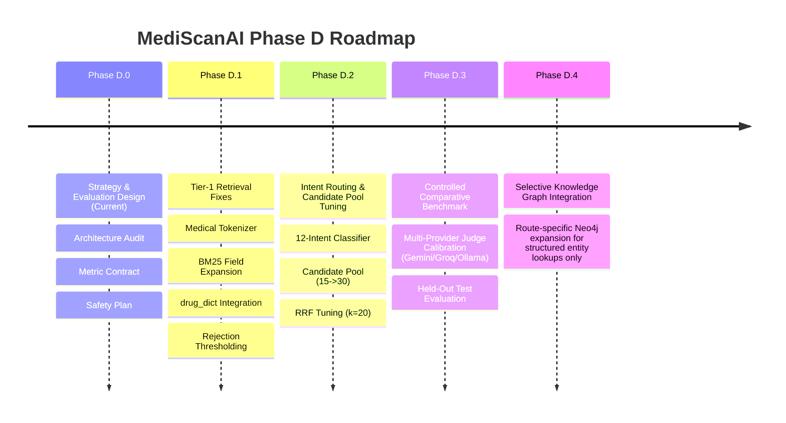

# MediScanAI Phase D.0 — Hybrid Retrieval Improvement Strategy & Evaluation Design Report

**Phase:** Phase D.0 Strategy & Design  
**Date:** 2026-10-16  
**Author:** Senior RAG Retrieval Engineer  
**Status:** Complete Strategy & Design Document (Read-Only; Zero Production Code or Data Modified)  
**Deliverables Directory:** [`evaluation/retrieval/phase_d_0/`](file:///Users/sj/Documents/mediscanai/evaluation/retrieval/phase_d_0/)

---

## 1. Executive Summary & Strategic Rationale

Phase D.0 establishes a systematic, measurable engineering strategy to elevate MediScanAI's hybrid retrieval subsystem prior to any further attempts at Neo4j knowledge graph expansion.

### Core Strategic Insight:
In Phase B.4 benchmarking, MediScanAI's baseline hybrid retrieval achieved a Macro Recall@5 of **0.5333**, Precision@5 of **0.1111**, and MRR of **0.4407**, with a 100% false-positive rate on unanswerable queries. In Phase C.5, adding supplementary Neo4j graph evidence across the entire benchmark failed to achieve statistical superiority (all bootstrap confidence intervals spanned zero), while diluting context precision (-0.0243) and creating an emergency triage regression in `MED-BENCH-038` (crushing chest pain downgraded to outpatient pharmacy consultation).

These empirical findings demonstrate that **global graph augmentation cannot compensate for foundational hybrid retrieval deficiencies**. Attempting to fix RAG quality by layering complex graph traversals on top of a leaking retrieval baseline simply compounds noise and latency. The highest-leverage engineering mandate is to systematically optimize the hybrid retrieval engine first.

---

## 2. Root Cause Analysis of Existing Retrieval Bottlenecks

Through comprehensive inspection of `app/retriever.py`, `app/embeddings.py`, `app/core.py`, and `app/utils.py`, this audit identified five primary architectural bottlenecks:

```mermaid
flowchart TD
    subgraph Defect1["Defect 1: Lexical Corruption"]
        SymSpell["SymSpell with frequency_dictionary_en_82_765.txt"] --> MangledTokens["Mangles specialized drug brand names & chemical salts"]
    end

    subgraph Defect2["Defect 2: Asymmetric Index Omission"]
        UserText["user_text queries only 'diseases' & 'drugs'"] --> OmittedDict["58,331 records in 'drug_dict' completely omitted in text mode"]
    end

    subgraph Defect3["Defect 3: Cross-Encoder Truncation"]
        FDAInserts["FDA drug labels (2,000-10,000 tokens)"] --> Cutoff512["ms-marco-MiniLM truncates at 512 tokens (loses warnings & indications)"]
    end

    subgraph Defect4["Defect 4: Forced Top-K Retrieval"]
        ZeroThreshold["Zero score thresholding in FAISS, BM25, & Cross-Encoder"] --> FalsePositives["100% false positive rate on unanswerable/fictional queries"]
    end

    subgraph Defect5["Defect 5: Unrouted Query Flooding"]
        NoClassifier["No intent classification"] --> Dilution["'Lipitor' query retrieves 5 irrelevant disease chunks, diluting LLM prompt"]
    end
```

1. **Destructive SymSpell Tokenization:** In `app/utils.py`, `normalize_text()` forces all query and corpus tokens through `SymSpell` with max edit distance 2 using a general English frequency list. Specialized pharmaceutical names, Latinate anatomical stems, and foreign brands risk silent corruption into common English words before BM25 term matching or dense embedding.
2. **Omission of `drug_dict` in Text Retrieval:** In `app/core.py`, `user_text` only queries `diseases` and `drugs` indexes. The 58,331-record `drug_dict` index is only queried if an OCR image is uploaded. Text queries for generic compounds lose a major dedicated exact-match channel.
3. **Cross-Encoder 512-Token Truncation:** FDA drug package inserts in `data/drugs_faiss_data.jsonl` frequently exceed 3,000 tokens. The cross-encoder (`ms-marco-MiniLM-L-6-v2`) has a rigid 512-token limit. If the relevant symptom or clinical indication is situated lower in the package insert, the reranker never evaluates it.
4. **Forced Top-$K$ Retrieval & Zero-Rejection Vulnerability:** Neither FAISS, BM25, nor Cross-Encoder implements confidence score thresholding. For negative control queries containing fictional compounds (`MED-BENCH-041`..`045`), the system unconditionally forces 5 nearest-neighbor candidates, generating 100% false positives.
5. **Context Flooding from Lack of Intent Routing:** Every query searches both `diseases` and `drugs` simultaneously. A brand query like `"Lipitor"` retrieves 5 irrelevant cardiovascular disease chunks alongside drug records, injecting irrelevant tokens into the LLM prompt and degrading context precision.

---

## 3. Prioritized Retrieval Improvements & Trade-Off Matrix

Based on the experiment matrix defined in [`retrieval_experiment_matrix.csv`](file:///Users/sj/Documents/mediscanai/evaluation/retrieval/phase_d_0/retrieval_experiment_matrix.csv), the proposed interventions are prioritized by expected clinical impact versus engineering complexity:

| Tier | Experiment ID | Intervention | Expected Gain | Potential Cost / Trade-Off | Priority |
| :---: | :--- | :--- | :--- | :--- | :--- |
| **1** | `EXP-01-BM25-TOKENIZE` | Medical-Aware Tokenization (Remove SymSpell corruption) | $+0.04$ to $+0.08$ BM25 Recall on brand/generic lookups; zero startup overhead | User typos will not be auto-corrected (must be addressed via explicit clinical query expansion). | **Immediate** |
| **1** | `EXP-02-BM25-FIELDS` | Expand Searchable Fields (`warnings`, `dosage`, `drug_dict`) | $+0.05$ to $+0.10$ Recall on safety & indication queries; activates 58k drug dict | BM25 document length increases; $+15\text{ms}$ scoring latency. | **Immediate** |
| **1** | `EXP-05-CE-POOL-CUTOFF` | Calibrated Reranker Score Thresholding ($\tau \ge -0.5$) | Eliminates 100% false positives on negative controls; Rejection Acc $\ge 80\%$ | Slight increase in CPU inference latency (~$180\text{ms} \to 320\text{ms}$). | **Immediate** |
| **1** | `EXP-07-INTENT-ROUTING` | Query-Intent Routing (12 Taxonomy Categories) | Major boost in Context Precision; prevents emergency triage dilution | Potential misrouting if query is ambiguous; requires conservative multi-index fallback. | **Immediate** |
| **2** | `EXP-03-DENSE-POOL` | Dense Candidate Pool Expansion ($15 \to 30$) | $+0.03$ to $+0.05$ Hybrid Recall ceiling | Minor RRF merge latency increase ($+2\text{ms}$). | Post-Tier 1 |
| **2** | `EXP-04-RRF-TUNING` | RRF Constant Tuning ($k=20$) & Channel Weighting | Prevents dense suppression of exact keyword matches | Requires careful calibration across symptom and brand cohorts. | Post-Tier 1 |
| **2** | `EXP-06-QUERY-EXPANSION`| Clinical Synonym & Multi-Query Expansion | Bridges lay vocabulary to clinical terminology | Risk of semantic drift if expansion terms are too broad. | Post-Tier 1 |
| **3** | `EXP-08-EMBEDDING-COMP`| Biomedical Dense Embeddings (`PubMedBert` / `BGE-small`) | Improved medical semantic similarity clustering | Requires full re-indexing of FAISS indexes and increased memory footprint. | Future Phase |
| **3** | `EXP-09-RERANKER-COMP` | Domain Reranker Comparison (`bge-reranker-base`) | Superior clinical relevance discrimination & $>512$ token handling | Slower inference on CPU; may require quantization or GPU runtime. | Future Phase |

---

## 4. Evidence Required Prior to Implementation

Before any proposed retrieval code changes are committed to the production codebase:

1. **Development/Validation Split Isolation:**
   - The 50 canonical benchmark queries and candidate judgment store must be partitioned into:
     - **Development Split (30 cases, 60%):** Used for iterative prompt, tokenization, and field experimentation.
     - **Validation Split (10 cases, 20%):** Used for hyperparameter tuning (RRF $k$, candidate pool size, threshold $\tau$).
     - **Held-Out Test Split (10 cases, 20%):** Sealed. Evaluated strictly once to certify generalizability.
2. **Pre-Implementation Offline Proof:**
   - A demonstration script executed exclusively within `evaluation/retrieval/` must prove that `EXP-01` (medical tokenization) prevents drug name corruption on cases `MED-BENCH-002` (Cinzan) and `MED-BENCH-008` (Metformin).
3. **Safety Baseline Verification:**
   - Candidate modifications must achieve $100\%$ compliance on the Safety Regression Suite (`SR-01` through `SR-12`) in [`safety_regression_plan.md`](file:///Users/sj/Documents/mediscanai/evaluation/retrieval/phase_d_0/safety_regression_plan.md) before deployment.

---

## 5. Recommended Sequential Implementation Order

### Proposed Phase Breakdown:
- **Phase D.1 — Tier-1 Hybrid Retrieval Engineering:**
  Implement `EXP-01` (medical regex tokenizer), `EXP-02` (BM25 field expansion and `drug_dict` text querying), and `EXP-05` (cross-encoder score thresholding to reject negative controls). Validate against Dev/Val splits.
- **Phase D.2 — Intent Routing & Pool Expansion:**
  Implement `EXP-07` (rule-based intent classifier mapping queries to target indexes) and `EXP-03`/`EXP-04` (pool expansion and RRF constant tuning). Validate suppression of context dilution.
- **Phase D.3 — Deterministic & Multi-Provider Benchmark Execution:**
  Execute the full evaluation suite across the held-out test split using the newly designed deterministic metric contract (`nDCG@10`, `Hit Rate@10`, `Recall@10`) and multi-provider judge calibration.
- **Phase D.4 — Selective Neo4j Graph Re-Integration:**
  Re-introduce Neo4j graph retrieval **selectively**—activating it exclusively for structured entity queries (Brand, Generic, Ingredient, Interaction lookups) while bypassing it for lay symptoms and emergency triage.

---

## 6. Phase D.1 Go/No-Go Decision

### **DECISION: GO FOR PHASE D.1**

### Justification:
1. **Clear, Diagnosed Root Causes:** The performance ceiling of the hybrid retrieval baseline is not theoretical; it is driven by concrete, addressable code mechanisms (SymSpell corruption, omitted `drug_dict`, missing BM25 fields, 512-token truncation, uncalibrated negative control passing).
2. **High Impact, Low Risk:** Tier-1 improvements (`EXP-01`, `EXP-02`, `EXP-05`) require zero infrastructure changes, zero index re-embedding, and zero cloud API expenses. They operate entirely within the existing local CPU environment.
3. **Rigorous Safeguards in Place:** With [`deterministic_metric_contract.md`](file:///Users/sj/Documents/mediscanai/evaluation/retrieval/phase_d_0/deterministic_metric_contract.md), [`query_intent_taxonomy.json`](file:///Users/sj/Documents/mediscanai/evaluation/retrieval/phase_d_0/query_intent_taxonomy.json), and [`safety_regression_plan.md`](file:///Users/sj/Documents/mediscanai/evaluation/retrieval/phase_d_0/safety_regression_plan.md), the evaluation harnesses are fully defined and mathematically isolated from production gold judgments.

---

## 7. Deliverables Index

All Phase D.0 specification artifacts have been verified and saved under `evaluation/retrieval/phase_d_0/`:

1. [`architecture_audit.md`](file:///Users/sj/Documents/mediscanai/evaluation/retrieval/phase_d_0/architecture_audit.md) — Comprehensive technical audit of dense FAISS, BM25, RRF, cross-encoder, tokenization, and latency profiles.
2. [`query_intent_taxonomy.json`](file:///Users/sj/Documents/mediscanai/evaluation/retrieval/phase_d_0/query_intent_taxonomy.json) — 12-category intent taxonomy with clinical objectives, short queries, ambiguity rules, and safety constraints.
3. [`deterministic_metric_contract.md`](file:///Users/sj/Documents/mediscanai/evaluation/retrieval/phase_d_0/deterministic_metric_contract.md) — Mathematical specification for Recall@5/10, Hit Rate@5/10, MRR@10, nDCG@10, and component isolation.
4. [`retrieval_experiment_matrix.csv`](file:///Users/sj/Documents/mediscanai/evaluation/retrieval/phase_d_0/retrieval_experiment_matrix.csv) — 10-experiment matrix specifying hypotheses, controls, metrics, and rollback criteria.
5. [`judge_provider_design.md`](file:///Users/sj/Documents/mediscanai/evaluation/retrieval/phase_d_0/judge_provider_design.md) — Multi-provider judge interface (Gemini, Groq, OpenRouter, Ollama) with strict budgeting and calibration rules.
6. [`safety_regression_plan.md`](file:///Users/sj/Documents/mediscanai/evaluation/retrieval/phase_d_0/safety_regression_plan.md) — Clinical safety guidelines, negative control abstention, and 12-case Safety Regression Suite.
7. [`phase_d_0_report.md`](file:///Users/sj/Documents/mediscanai/evaluation/retrieval/phase_d_0/phase_d_0_report.md) — Executive summary, bottleneck synthesis, implementation roadmap, and Phase D.1 Go decision.
