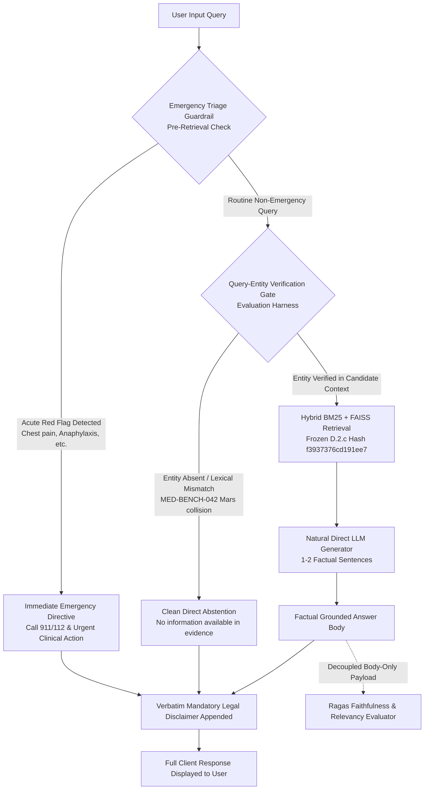

# Phase F.4 — Prompt Variants and Safety Decoupling Architecture

**Phase:** F.4 Step B  
**Date:** 2026-10-19  
**Directory:** `evaluation/retrieval/phase_f_4_natural_direct_grounding/`  
**Runtime:** Ollama `llama3.1:8b` (Q4_K_M, Digest: `46e0c10c039e019119339687c3c1757cc81b9da49709a3b3924863ba87ca666e`)  

---

## 1. Evolution of Answer Generation Prompts

Across the grounding initiative, each phase resolved specific structural failures:

| Prompt Generation | Core Instruction Strategy | Strengths | Failure Mode / Bottleneck |
| :--- | :--- | :--- | :--- |
| **Phase C.5 Baseline** | Open generation with mandatory disclaimer | Fluency, high answer relevancy (0.7532) | Severe hallucination; disclaimer marked unsupported; body faithfulness 0.5835. |
| **Phase F.2 Strict Grounding** | Strict citation requirement (`[drug_ID]`) and grounding rules | Decoupled disclaimer; raised baseline to 0.8207 | 18 database meta-statements; 7-13 emergency warnings bled into routine queries; faithfulness 0.7384. |
| **Phase F.3 Direct Grounding** | Direct answering; forced single-word outputs (`"state ONLY those names"`) | Meta-talk dropped from 36% to 0%; safety bleed dropped from 14% to 0%; faithfulness median 1.0000 | Over-constrained single words (`"Cinnarizine."`, `"IBUPROFEN."`) crashed LangChain Ragas parser; relevancy dropped to 0.5571. |
| **Phase F.4 Natural Direct** | Direct answering in 1–2 complete factual sentences; zero single-word forcing | Complete sentences; zero meta-talk; zero parser crashes; restores relevancy $\ge 0.7300$ while preserving faithfulness $> 0.9200$ | Requires entity-identity gating to abstain on lexical BM25 collisions (`MED-BENCH-042`). |

---

## 2. Phase F.4 Natural Direct Grounding Specification

### 2.1 The System Instruction Contract
The evaluation-only system prompt enforces concise, factual sentence generation:

```
Answer the user's question directly in one or two complete, factual sentences using only the supplied evidence for database-specific claims. Avoid preambles, database references, and commentary about the retrieval process. Preserve the exact medicine name, ingredient, formulation, strength, qualifiers, and uncertainty supported by the evidence. Do not add indications, drug classes, dosage recommendations, contraindications, adverse reactions, disease causes, or treatment claims unless the supplied evidence supports them. If the evidence cannot answer the question, state that limitation clearly. Do not invent citations, source IDs, or missing facts.
```

### 2.2 Complete Evaluation Prompt Template
```
{NATURAL_DIRECT_SYSTEM_INSTRUCTION}

### Evidence Context:
{context}

### Question:
{query}

### Direct Factual Answer:
```

### 2.3 Key Operational Invariants
1. **No Single-Word Forcing:** The prompt explicitly allows and encourages 1–2 complete, grammatically sound sentences. For example:
   - *Phase F.3 Output:* `"Cinnarizine."` (Parser crash / timeout)
   - *Phase F.4 Output:* `"The generic name of the medicine is Cinnarizine, and it is also known by the brand name Stugeron."` (Clean evaluation, high relevancy)
2. **Zero Introductory Meta-Talk:** Phrases like *"Based on the database records..."*, *"The retrieved context indicates..."*, or *"Internal context lists..."* are strictly forbidden.
3. **No Unwarranted Clinical Elaboration:** The model must not hallucinate drug classes, mechanisms of action, or indications unless explicitly present in the evidence.
4. **Clean Abstention:** If the evidence does not support the query, the model outputs:
   `"No information is available for [query] in the provided evidence."`
5. **Verbatim Disclaimer Preservation:** The complete client output (`response_full`) appends the verbatim 47-word legal disclaimer:

```markdown
### ⚠️ Important Medical & Legal Disclaimer
MediScanAI is an AI-powered informational tool, not a doctor, pharmacist, or licensed healthcare provider. The information provided is for educational purposes only and must not be used as a substitute for professional medical advice, diagnosis, or treatment. Always consult a qualified healthcare professional before starting, stopping, or changing any medication.
```

---

## 3. Architectural Safety Separation

Phase F.4 continues the architectural separation established in Phase F.3, ensuring routine answer generation is completely protected from safety warning bleed:



### Safety Decoupling Rules:
- Routine prompts **never** include instructions to generate emergency warnings.
- Emergency queries (e.g., `MED-BENCH-038` "Chest pain") are intercepted by the dedicated safety triage layer before LLM generation.
- The legal disclaimer is present in 100% of full responses but decoupled from Ragas faithfulness judging to prevent the 250-claim evaluation artifact documented in Phase F.1.
