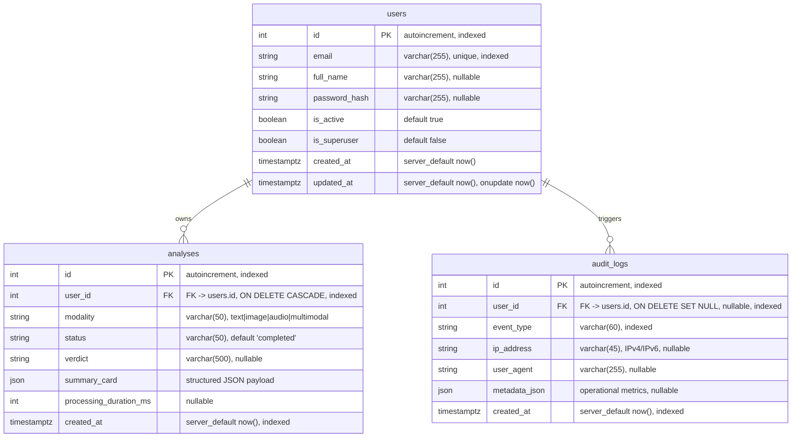

# MediScanAI — Database, Authentication & Data Minimization Audit

**Document:** `mediscanai-app-spec/04_DATABASE_AUTH_DATA_AUDIT.md`  
**Status:** Complete Technical Specification  
**Database Engine:** PostgreSQL 15-alpine (with SQLite fallback for isolated unit testing)  
**ORM & Migrations:** SQLAlchemy 2.0 + Alembic 1.12.0  
**Baseline Code:** `backend/models/`, `backend/db/`, `alembic/versions/`, `backend/core/security.py`

---

## 1. Executive Summary

MediScanAI utilizes a relational PostgreSQL database engineered with strict **Privacy by Design** and **Data Minimization** principles. The database stores user identity records, operational audit logs, and data-minimized structured analysis cards.

**Critical Privacy Safeguards:**
- **Zero Raw Media Storage:** Raw uploaded photos of medicine packages and recorded voice audio clips are never saved into database columns or persistent disk storage. Temporary files are stored in OS temp space with random UUIDs and permanently unlinked in a `finally` block immediately after inference.
- **Credential Protection:** User passwords are encrypted using **bcrypt** with salted hashing. Plaintext passwords never touch logs or persistent records.
- **Bearer Token Isolation:** JWT access tokens are signed statelessly using HMAC-SHA256 (`HS256`) and are never written to the database.
- **Tenant Isolation:** Every analysis record is tied via foreign key to a specific `user_id`. API queries enforce ownership filtering at the SQL level, preventing cross-user data leakage.

---

## 2. Relational Schema & Entity-Relationship Model



---

## 3. Table Column Specifications

### 3.1 `users` Table
Defines registered user accounts. Created in migration `0001_initial_schema` and updated in `0002_add_user_full_name`.

| Column | Type | Nullable | Constraints & Defaults | Description |
| :--- | :--- | :--- | :--- | :--- |
| `id` | `INTEGER` | No | Primary Key, Autoincrement, Indexed | Unique internal user ID |
| `email` | `VARCHAR(255)` | No | Unique, Indexed | Normalized user email (lowercase, stripped) |
| `full_name` | `VARCHAR(255)` | Yes | Default: `NULL` | Optional display name of user |
| `password_hash` | `VARCHAR(255)` | Yes | Default: `NULL` | Salted bcrypt password hash |
| `is_active` | `BOOLEAN` | No | Default: `true` | Account active flag (disabled accounts rejected) |
| `is_superuser` | `BOOLEAN` | No | Default: `false` | Administrative access flag |
| `created_at` | `TIMESTAMPTZ` | No | Server Default: `now()` | Timestamp of registration |
| `updated_at` | `TIMESTAMPTZ` | No | Server Default: `now()`, Auto-update | Timestamp of profile update |

---

### 3.2 `analyses` Table
Stores completed clinical evaluations. Created in migration `0003_add_analysis_and_audit_tables`.

| Column | Type | Nullable | Constraints & Defaults | Description |
| :--- | :--- | :--- | :--- | :--- |
| `id` | `INTEGER` | No | Primary Key, Autoincrement, Indexed | Unique analysis record ID |
| `user_id` | `INTEGER` | No | Foreign Key (`users.id`), Indexed, `ON DELETE CASCADE` | Owner user ID |
| `modality` | `VARCHAR(50)` | No | None | Modality tag (`text`, `image`, `audio`, `multimodal`) |
| `status` | `VARCHAR(50)` | No | Default: `'completed'` | Processing status lifecycle tag |
| `verdict` | `VARCHAR(500)` | Yes | Default: `NULL` | Structured headline snippet for history list |
| `summary_card` | `JSON` / `JSONB` | No | None | Complete data-minimized result card |
| `processing_duration_ms` | `INTEGER` | Yes | Default: `NULL` | Total execution time in milliseconds |
| `created_at` | `TIMESTAMPTZ` | No | Server Default: `now()`, Indexed | Timestamp of analysis creation |

*Cascading Behavior:* When a user is deleted, all associated `analyses` records are automatically deleted via `ON DELETE CASCADE`.

---

### 3.3 `audit_logs` Table
Maintains security and operational audit records. Created in migration `0003_add_analysis_and_audit_tables`.

| Column | Type | Nullable | Constraints & Defaults | Description |
| :--- | :--- | :--- | :--- | :--- |
| `id` | `INTEGER` | No | Primary Key, Autoincrement, Indexed | Unique audit event ID |
| `user_id` | `INTEGER` | Yes | Foreign Key (`users.id`), Indexed, `ON DELETE SET NULL` | Associated user ID if authenticated |
| `event_type` | `VARCHAR(60)` | No | Indexed | Audit event category tag |
| `ip_address` | `VARCHAR(45)` | Yes | Default: `NULL` | Client IP address (IPv4 or IPv6) |
| `user_agent` | `VARCHAR(255)` | Yes | Default: `NULL` | Client User-Agent header snippet |
| `metadata_json` | `JSON` | Yes | Default: `NULL` | Structured operational metadata |
| `created_at` | `TIMESTAMPTZ` | No | Server Default: `now()`, Indexed | Audit event timestamp |

*Audit Event Taxonomy:*
- `AUTH_REGISTER`: Successful user creation.
- `AUTH_REGISTER_FAILED`: Registration failure (duplicate email).
- `AUTH_LOGIN_SUCCESS`: Successful authentication.
- `AUTH_LOGIN_FAILURE`: Invalid credentials or inactive account.
- `ANALYSIS_CREATED`: Multimodal analysis completed and persisted.
- `ANALYSIS_ACCESSED`: Analysis detail inspected by owner.
- `ANALYSIS_DELETED`: Analysis record deleted by owner.
- `RATE_LIMIT_EXCEEDED`: User exceeded per-minute request quota.
- `CONCURRENCY_LIMIT_EXCEEDED`: Request rejected due to slot saturation.
- `EMERGENCY_GUARDRAIL_TRIGGERED`: Critical clinical emergency intercepted.
- `OCR_PROCESSING_FAILED`: Image unreadable or OCR engine exception.

*Privacy in Audit Logging:* The `metadata_json` column strictly excludes medical symptom text, transcribed audio, extracted OCR strings, passwords, and authorization tokens.

---

## 4. Alembic Migration History

The schema evolution is tracked via Alembic under `alembic/versions/`:

1. **`0001_initial_schema` (`0001_initial_schema.py`):**
   - Creates the initial `users` table with `id`, `email`, `password_hash`, `is_active`, `is_superuser`, `created_at`, `updated_at`.
   - Creates unique index on `email` and index on `id`.
2. **`0002_add_user_full_name` (`0002_add_user_full_name.py`):**
   - Adds `full_name` (`VARCHAR(255)`) to `users`.
   - Down revision links to `0001_initial_schema`.
3. **`0003_analysis_and_audit` (`0003_add_analysis_and_audit_tables.py`):**
   - Creates `analyses` table with foreign key to `users.id` (`ON DELETE CASCADE`).
   - Creates `audit_logs` table with foreign key to `users.id` (`ON DELETE SET NULL`).
   - Adds indexes on `user_id`, `created_at`, and `event_type`.
   - Down revision links to `0002_add_user_full_name`.

---

## 5. Authentication & Token Architecture

1. **Password Hashing:**
   - Implemented in `backend/core/security.py` using `bcrypt.hashpw(password.encode('utf-8'), bcrypt.gensalt())`.
   - Verification uses `bcrypt.checkpw(plain.encode('utf-8'), hashed.encode('utf-8'))`.
2. **JWT Access Tokens:**
   - Generated with `pyjwt` using secret key `settings.JWT_SECRET_KEY` and algorithm `HS256`.
   - Token Payload:
     ```json
     {
       "sub": "1",
       "exp": 1731896400
     }
     ```
   - Lifetime: 60 minutes (`ACCESS_TOKEN_EXPIRE_MINUTES = 60`).
3. **Session Verification Pipeline:**
   - Incoming request carries `Authorization: Bearer <token>`.
   - `backend/api/deps.py` (`get_current_active_user`) decodes the token, extracts the subject user ID, queries `users`, and verifies `is_active == True`.
   - If invalid or expired, raises HTTP 401 with `WWW-Authenticate: Bearer`.

---

## 6. Guidance for Native iOS Client

1. **Keychain for Token Storage:** The iOS client must store the JWT `access_token` in the secure Apple Keychain using `kSecClassGenericPassword`. It must never store tokens in plain `UserDefaults`.
2. **Zero Direct Database Connections:** The iOS app must never connect to PostgreSQL directly (port 5432 remains isolated within Docker). All database operations occur through the authenticated REST API.
3. **Strict Data Minimization on Device:**
   - The iOS app should not store raw photos or audio recordings in its local application directory after upload.
   - Analysis results should be cached in memory or transient storage, relying on `GET /api/analyses` for history rehydration.

