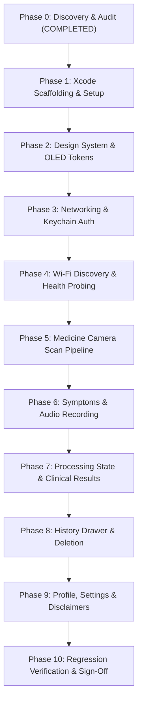

# MediScanAI — iOS Implementation Readiness Report & Phased Roadmap

**Document:** `mediscanai-app-spec/08_IMPLEMENTATION_READINESS_REPORT.md`  
**Status:** Readiness Evaluation & Strategic Roadmap  
**Readiness Verdict:** **GO (Fully Ready for Implementation)**  
**Target Repository:** `sj/mediscanai` (`main` branch @ `776390e`)  
**Scope:** Phased Implementation Strategy (Phase 0 through Phase 10)

---

## 1. Readiness Evaluation & Technical Baseline

Based on the thorough read-only investigation of the MediScanAI codebase, the repository is **technically and operationally ready** for the native iOS application implementation.

### Key Readiness Dimensions
1. **Backend API Stability:** All required endpoints (`/api/health`, `/api/ready`, `/api/auth/*`, `/api/analyze`, `/api/analyses/*`) are implemented, documented, and covered by 32 deterministic automated tests.
2. **AI Inference Pipeline:** Local PaddleOCR, Faster-Whisper, and FAISS hybrid retrieval operate reliably on Apple Silicon (M4), with seamless online fallback to Gemini 3.6/3.7 Flash and Groq OSS 120B/20B.
3. **Database & Data Minimization:** PostgreSQL schema and Alembic migrations enforce user isolation, with raw image/audio data completely unlinked after processing.
4. **Website Non-Regression Protection:** Baseline builds and linters are verified (`npm run build` exits 0 in 180ms; `oxlint` reports 0 errors).
5. **Clear Architectural Boundaries:** The iOS application will reside strictly in `ios/`, ensuring complete isolation from web frontend and backend codebases.

---

## 2. 11-Phase Implementation Roadmap (Phase 0 – Phase 10)

---

### Phase 0: Pre-Implementation Discovery & Audit (COMPLETED)
- **Goal:** Comprehensively audit the repository, verify existing API contracts, database schemas, AI pipelines, and web baselines without modifying application code.
- **Deliverables:**
  - `01_EXISTING_PRODUCT_AUDIT.md`
  - `02_BACKEND_API_AUDIT.md`
  - `03_AI_PIPELINE_AUDIT.md`
  - `04_DATABASE_AUTH_DATA_AUDIT.md`
  - `05_IOS_ARCHITECTURE_RECOMMENDATION.md`
  - `06_IOS_UI_UX_DESIGN_RECOMMENDATION.md`
  - `07_TESTING_SECURITY_NON_REGRESSION_AUDIT.md`
  - `08_IMPLEMENTATION_READINESS_REPORT.md`
  - Reconciled PRD and Design Documents.
  - `AUDIT_INDEX.md`.
- **Exit Condition:** All technical unknowns resolved; full documentation baseline established.

---

### Phase 1: Xcode Project Scaffolding & Structure
- **Goal:** Initialize a clean, native Xcode project in `ios/MediScanAI` targeting iOS 17.0+ with modern Swift 5.10 / 6.0 settings.
- **Key Tasks:**
  - Create directory layout: `App/`, `Core/`, `Features/`, `Resources/`.
  - Configure `Info.plist` with `NSAllowsLocalNetworking` and hardware sensor usage descriptions.
  - Set up `PrivacyInfo.xcprivacy` manifest.
  - Configure unit test and UI test targets (`MediScanAITests`, `MediScanAIUITests`).
- **Exit Condition:** Xcode project builds cleanly on iPhone Simulator and physical device with zero warnings.

---

### Phase 2: Design System & Monochromatic OLED Components
- **Goal:** Implement the approved true-black design system and reusable SwiftUI components.
- **Key Tasks:**
  - Define `Color` extension tokens (`background: #000000`, `surfacePrimary: #0A0A0A`, `borderSubtle: #2A2A2A`).
  - Implement San Francisco Dynamic Type hierarchy with tabular numeric styling.
  - Build reusable components: `PrimaryButton`, `SurfaceCard`, `VerdictBadge`, `StatusIndicator`, `NoticeBanner`.
- **Exit Condition:** SwiftUI previews for all design system components render correctly in dark mode.

---

### Phase 3: Networking Layer, Keychain Authentication & Session State
- **Goal:** Implement the async/await `APIClient`, Keychain token storage, and authentication state machine.
- **Key Tasks:**
  - Build `KeychainStorage` for secure JWT persistence.
  - Implement `APIEndpoint` builder and `APIClient` protocol.
  - Implement `POST /api/auth/register`, `POST /api/auth/login`, and `GET /api/auth/me`.
  - Build `LoginView`, `RegisterView`, and `AuthViewModel`.
  - Implement automatic 401 interception and session teardown.
- **Exit Condition:** Complete end-to-end user registration, login, and session restoration verified against local backend.

---

### Phase 4: Local Wi-Fi Discovery & Server Health Probing
- **Goal:** Enable dynamic LAN IP configuration and visual health verification.
- **Key Tasks:**
  - Implement `ServerConfig` storing local base URL (e.g., `http://192.168.1.100:8000`).
  - Build connection testing mechanism pinging `GET /api/health`.
  - Add visual connectivity badge to Home screen header (`🟢 Local Wi-Fi Connected` vs `🔴 Offline`).
- **Exit Condition:** User can change backend IP address and verify real-time connectivity status.

---

### Phase 5: Medicine Packaging Scan & Camera Pipeline
- **Goal:** Build the native camera capture and photo library selection pipeline.
- **Key Tasks:**
  - Implement `CameraService` using `AVCaptureSession` with corner framing reticles.
  - Implement `PhotosPicker` integration for gallery selection.
  - Build `PhotoPreviewSheet` allowing image review, retake, or submission.
  - Implement `ImageCompressor` ensuring payloads are high quality yet under 8 MB.
- **Exit Condition:** User can snap or select packaging photos with smooth preview and validation.

---

### Phase 6: Symptom Entry & Audio Recording Pipeline
- **Goal:** Implement natural language symptom logging and voice recording.
- **Key Tasks:**
  - Build spacious `SymptomEntryView` with multiline text editor.
  - Implement `AudioRecorderService` using `AVAudioRecorder` producing 16-bit PCM WAV or M4A.
  - Build interactive audio recording modal with live waveform visualizer and duration timer.
  - Attach audio and image chips to the unified multimodal composer.
- **Exit Condition:** Multimodal payloads combining text, audio clips, and packaging photos are cleanly assembled.

---

### Phase 7: Processing State Machine & Clinical Results Presentation
- **Goal:** Stream multipart analysis requests to `/api/analyze` and render rich structured results.
- **Key Tasks:**
  - Implement `MultipartBuilder` streaming `text`, `image`, and `audio` form parts.
  - Build `ProcessingView` with dual-ring spinner and dynamic stage message cross-fades.
  - Implement `ResultDetailView`:
    - Dynamic Verdict Banner (Danger / Success / Caution).
    - Markdown clinical explanation.
    - Suggested pharmacological alternatives.
    - Collapsible RAG evidence accordions (Diseases, Drugs, Drug Dict).
    - Emergency Warning Banner (112 / 911).
- **Exit Condition:** Full multimodal analysis completes end-to-end, displaying rich structured cards with accurate verdict styling.

---

### Phase 8: Analysis History Drawer & Deletion Flow
- **Goal:** Rehydrate past analyses from PostgreSQL and enable user deletion.
- **Key Tasks:**
  - Implement `GET /api/analyses` with pagination support.
  - Build `HistoryListView` with modality icons, timestamps, and verdict snippets.
  - Implement `GET /api/analyses/{id}` rehydrating the full ResultDetailView.
  - Implement `DELETE /api/analyses/{id}` with swipe-to-delete and haptic feedback.
- **Exit Condition:** History items synchronize accurately with backend database; deletions update instantly.

---

### Phase 9: Profile, Settings & Privacy Disclaimers
- **Goal:** Complete the account management, settings, and legal medical disclosures.
- **Key Tasks:**
  - Build `ProfileView` displaying user identity, server connection info, and sign-out button.
  - Add native legal disclosures explaining that MediScanAI is an educational decision-support tool.
  - Implement clean sign-out workflow wiping Keychain tokens and resetting navigation.
- **Exit Condition:** Profile screen is feature-complete with zero dead controls.

---

### Phase 10: Regression Verification & Physical Device Sign-Off
- **Goal:** Validate physical iPhone performance, run non-regression gates, and certify release readiness.
- **Key Tasks:**
  - Execute full website non-regression suite (`npm run build`, `npm run lint`).
  - Execute backend test suite (`pytest tests/unit tests/api tests/database tests/test_e2e_smoke.py`).
  - Deploy iOS app to physical iPhone on local Wi-Fi.
  - Verify camera capture, microphone recording, analysis execution, and battery efficiency.
  - Document operating runbook and physical device testing evidence.
- **Exit Condition:** 100% pass across web, backend, and native iOS regression test suites.

