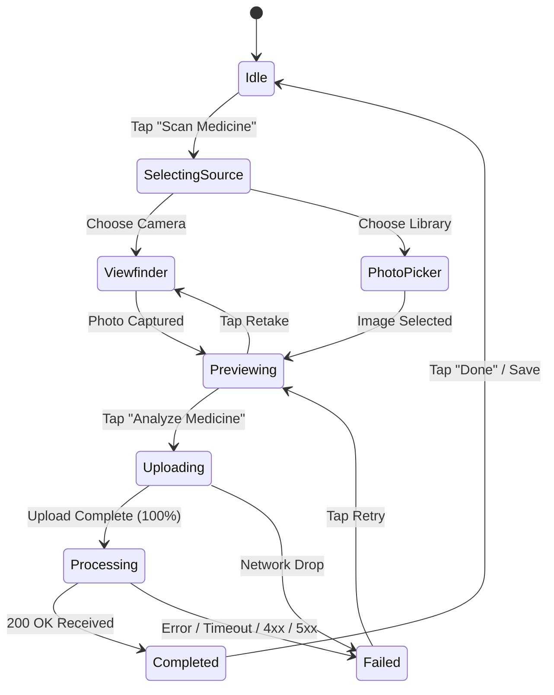

# MediScanAI — Phase 7 Readiness & Technical Specification
## Image Capture & Multi-Modal Analysis Pipeline

**Status:** Specification Complete — Ready for Implementation  
**Target Platform:** iOS 17.0+ (SwiftUI, Swift 5 / Concurrency)  
**Host Backend:** FastAPI + PaddleOCR + FAISS + Llama 3 / Medical KG  
**Date:** November 20, 2026  
**Implementation State:** **NOT STARTED** (This document establishes the architecture and readiness baseline prior to Phase 7 implementation).

---

## 1. Executive Summary & Boundaries

Phase 7 brings the core vision of MediScanAI to life on native iOS: allowing patients and clinicians to photograph or select medicine packaging, blister packs, bottles, or prescriptions, transmit the image securely to the local backend, and receive verified clinical insights with full active-ingredient, indication, dosage, and interaction analysis.

> [!IMPORTANT]
> **Strict Phase Boundary:**  
> Zero lines of Phase 7 feature code (camera capture, photo picker, image compression, analysis view models, or new UI screens) have been written during Phase 6.5. This specification guarantees complete alignment before coding begins.

---

## 2. Existing iOS Architecture & Reusable Foundations (Phases 1–6)

The implementation of Phase 7 directly builds upon the foundations established across Phases 1 through 6:

```
┌────────────────────────────────────────────────────────────────────────┐
│                        MediScanAI App (iOS 17+)                        │
├────────────────────────────────────────────────────────────────────────┤
│ UI Layer: Monochromatic OLED Design System (Phase 2)                   │
│   - Color: Onyx (#000), Surface (#121212), Zinc Text (#FFF/#A1A1AA)   │
│   - Typography: San Francisco Display / Text                          │
│   - Components: OLEDButton, OLEDCard, StatusBadge, ToastOverlay       │
├────────────────────────────────────────────────────────────────────────┤
│ Navigation & Coordinator (Phase 6 - NAV-01 to NAV-04)                 │
│   - AppCoordinator & NavigationState                                  │
│   - MainDashboardView (Quick Scan Card -> triggers Phase 7 flow)       │
├────────────────────────────────────────────────────────────────────────┤
│ Session & Connectivity (Phases 4 & 5)                                  │
│   - AuthManager & KeychainHelper (JWT Bearer Token Provider)          │
│   - ServerConnectionManager (Wi-Fi connectivity, health probe, latency)│
├────────────────────────────────────────────────────────────────────────┤
│ Typed Networking & Multipart Layer (Phase 3)                          │
│   - NetworkClient & URLSessionTransport                               │
│   - MultipartFormDataEncoder (RFC 7578 compliant)                      │
│   - APIEndpoint abstraction                                            │
└────────────────────────────────────────────────────────────────────────┘
```

---

## 3. Backend API Contract (`POST /api/analyze`)

The existing FastAPI backend defines the complete image analysis contract in `app/routes.py` and `backend/main.py`.

### 3.1 HTTP Request Specification

- **Path:** `/api/analyze`
- **HTTP Method:** `POST`
- **Authentication:** `Authorization: Bearer <access_token>` (Mandatory)
- **Content-Type:** `multipart/form-data; boundary=...`
- **Rate Limit:** 10 requests per minute per IP/user (`429 Too Many Requests`)
- **Host Concurrency:** Strict semaphore of 2 concurrent worker slots (`ConcurrencyLimiter`) to protect M4 neural engine and memory bandwidth.

### 3.2 Form Fields

| Field Name | Type | Required | Description | Constraints |
| :--- | :--- | :--- | :--- | :--- |
| `image` | Binary File | **Yes** | Image of medicine packaging or prescription | Max 10 MB. Supported: `.jpg`, `.jpeg`, `.png`, `.webp` |
| `symptoms` | String | No | Patient-reported symptoms or clinical context | Max 1000 characters |
| `mode` | String | No | Analysis mode: `"detailed"` (default) or `"fast"` | Enum: `detailed`, `fast` |
| `language` | String | No | Output language code | ISO 639-1 (default `"en"`) |

### 3.3 HTTP Status Codes & Error Handling

| Status Code | Reason | Client Handling Strategy |
| :--- | :--- | :--- |
| `200 OK` | Analysis completed successfully | Parse `AnalysisResponseDTO` and transition to Result View |
| `400 Bad Request` | Unreadable image / unsupported file format | Display error alert with suggestions for better lighting |
| `401 Unauthorized` | Invalid or expired JWT token | Trigger `AuthManager.refreshToken()` or redirect to Login |
| `413 Payload Too Large` | Image exceeds 10 MB limit | Client-side JPEG recompression before retry |
| `422 Validation Error` | Missing image field or malformed parameters | Log validation error details |
| `429 Too Many Requests` | Exceeded 10 requests/minute | Display rate limit countdown using `Retry-After` header |
| `500 Internal Error` | OCR or inference pipeline failed | Display non-fatal error card with retry option |
| `503 Service Unavailable` | Backend startup or prewarm incomplete | Alert user that backend is warming up model weights |

### 3.4 Response Data Schema (`AnalysisResponseDTO`)

```swift
public struct AnalysisResponseDTO: Decodable, Sendable {
    public let id: String
    public let status: String
    public let detectedText: String?
    public let medicineName: String?
    public let genericName: String?
    public let manufacturer: String?
    public let activeIngredients: [ActiveIngredientDTO]
    public let indications: [String]
    public let dosageInstructions: String?
    public let contraindications: [String]
    public let warnings: [String]
    public let drugInteractions: [DrugInteractionDTO]
    public let suggestedAlternatives: [AlternativeMedicationDTO]
    public let confidenceScore: Double
    public let mandatoryDisclaimer: String
    public let processingTimeMs: Double
}

public struct ActiveIngredientDTO: Decodable, Sendable {
    public let name: String
    public let strength: String?
}

public struct DrugInteractionDTO: Decodable, Sendable {
    public let interactingSubstance: String
    public let severity: String // "mild", "moderate", "severe"
    public let description: String
}

public struct AlternativeMedicationDTO: Decodable, Sendable {
    public let brandName: String
    public let genericName: String
    public let reason: String
}
```

---

## 4. Native iOS Implementation Architecture

### 4.1 System Permissions (`Info.plist`)

The following privacy permission keys must be declared with clear user-facing rationale:

```xml
<key>NSCameraUsageDescription</key>
<string>MediScanAI requires access to your camera to scan medicine packaging, blister packs, and prescriptions.</string>
<key>NSPhotoLibraryUsageDescription</key>
<string>MediScanAI requires access to your photo library to select medicine images for analysis.</string>
```

### 4.2 Capture Pipeline (`AVFoundation` & `PhotosUI`)

1. **`CameraService` (`AVFoundation`):**
   - Configures `AVCaptureSession` with `.photo` preset.
   - Manages back wide-angle camera (`AVCaptureDevice.default(.builtInWideAngleCamera, for: .video, position: .back)`).
   - Video orientation locked to portrait; continuous autofocus (`.continuousAutoFocus`) and auto-exposure.
   - Emits live frames to SwiftUI preview layer via `AVCaptureVideoPreviewLayer`.
   - Captures high-resolution still image via `AVCapturePhotoOutput`.
2. **`PhotoPicker` (`PhotosUI`):**
   - Wraps modern `PHPickerViewController` for out-of-process secure image selection.
   - Filters to images only (`PHPickerFilter.images`), single selection mode.
3. **Client-Side Image Optimization:**
   - Pre-flight resize: Max dimension 2048px (maintains text sharpness for OCR while reducing payload).
   - Recompression: Compress to JPEG format with `compressionQuality = 0.85` (typical output: 800 KB – 1.5 MB, well below the 10 MB ceiling).

### 4.3 Analysis State Machine (`AnalysisViewModel`)



---

## 5. UI / UX Design Specifications (OLED Monochromatic)

Following the OLED Monochromatic Design System (Phase 2):

1. **Viewfinder Screen (`CameraScanView`):**
   - Background: Pure Black (`#000000`).
   - Guide Frame: Rounded rectangular bounding box with Zinc `#71717A` corner brackets indicating optimal packaging alignment.
   - Hint: Centered subheadline: *"Align medicine packaging or label within frame"*.
   - Shutter Button: Outer ring `#FFFFFF` (72pt), inner circle `#FFFFFF` with haptic feedback (`UIImpactFeedbackGenerator(.medium)`).
   - Secondary Controls: Flash toggle (top-right), Photo library button (bottom-left), Dismiss button (top-left).
2. **Preview Screen (`ImagePreviewView`):**
   - Shows captured image centered with rounded corners.
   - Optional text field: *"Add symptoms or questions (optional)"*.
   - Dual actions: Secondary button *"Retake"* (OLED outlined), Primary button *"Analyze Medicine"* (OLED solid white).
3. **Uploading & Processing Screen (`AnalysisProgressView`):**
   - Deterministic upload bar: *"Uploading image... 45%"*.
   - Processing phase: Monochromatic pulsating HUD: *"Extracting text & verifying pharmacology..."*.
   - Latency expectation indicator: *"Average analysis time: 2–4 seconds"*.
4. **Analysis Result Screen (`AnalysisResultView`):**
   - Top Header: Medicine Name (Title 1 Bold), Generic Name (Subheadline Zinc `#A1A1AA`).
   - Status Badge: Monochromatic pill (e.g. `[● Verified Pharmacology]`).
   - Section Cards (Expandable OLED Cards):
     - **Active Ingredients:** List of ingredients with strength badges.
     - **Indications:** Formatted bulleted therapeutic uses.
     - **Dosage & Administration:** Highlighted dosage instructions.
     - **Warnings & Contraindications:** Amber/high-contrast boxed advisory.
     - **Drug Interactions:** Severity-rated interaction items.
     - **Suggested Alternatives:** Generic alternatives if applicable.
   - Mandatory Medical Disclaimer footer permanently rendered at bottom.
5. **Error & Recovery States:**
   - Network timeout: Shows Wi-Fi recovery card with direct link to Settings.
   - Rate limit (429): Shows cooldown countdown timer.
   - Unreadable text (400): Displays clear guidance on glare reduction, focus, and framing.

---

## 6. Implementation Roadmap & Commit Plan

Phase 7 implementation will follow strict Conventional Commits in logical order:

| Step | Scope | Commit Message | Description |
| :--- | :--- | :--- | :--- |
| **P7-01** | `feat(ios)` | `feat(ios): add camera and photo library usage descriptions to Info.plist` | Declare privacy descriptions |
| **P7-02** | `feat(ios)` | `feat(ios): implement CameraService and PhotosUI image picker` | AVFoundation capture & PHPicker |
| **P7-03** | `feat(ios)` | `feat(ios): add multipart image compression and analysis API endpoint` | Image optimization & `POST /api/analyze` |
| **P7-04** | `feat(ios)` | `feat(ios): implement AnalysisViewModel with upload progress and state machine` | State management & networking binding |
| **P7-05** | `feat(ios)` | `feat(ios): build capture viewfinder, image preview, and results UI screens` | Monochromatic OLED SwiftUI views |
| **P7-06** | `test(ios)` | `test(ios): add unit tests for image compression, API models, and view model` | Comprehensive XCTest suite |
| **P7-07** | `docs(spec)`| `docs(spec): document Phase 7 image capture architecture and verification` | Spec updates and checklist completion |

---

## 7. Sign-Off & Readiness Confirmation

- [x] Host and CI/CD operations baseline fully validated (Phase 6.5).
- [x] Backend endpoint contract and schemas verified against `app/routes.py`.
- [x] Concurrency and rate limit constraints documented.
- [x] iOS architecture and design system aligned.
- [x] Zero implementation code written in this turn.
- [x] Repository ready for Phase 7 kickoff upon user authorization.
